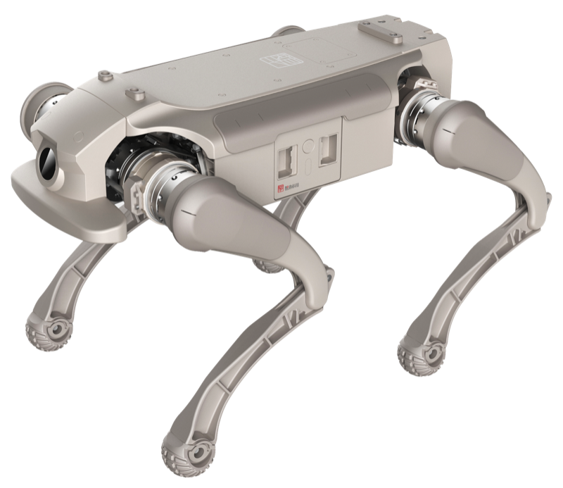
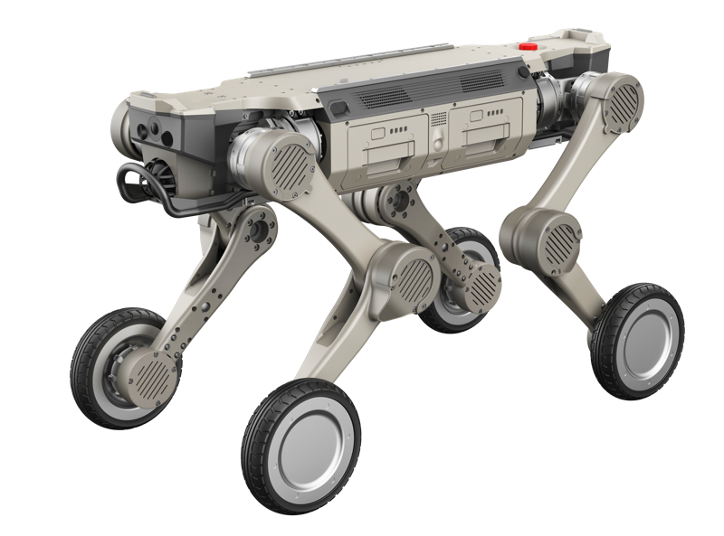
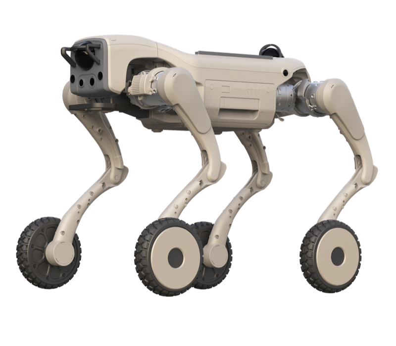

**开发者文档**

[文档站主页](https://zsibot.github.io/genisom_docs/) · [智身钢镚L1文档](https://zsibot.github.io/genisom_docs/l1/) · [智身铜锤 M1文档](https://zsibot.github.io/genisom_docs/m1/) · [智身钢镚 L2 文档](https://zsibot.github.io/genisom_docs/l2/)

[English homepage](https://zsibot.github.io/genisom_docs/en/) · [L1 English docs](https://zsibot.github.io/genisom_docs/l1-en/) · [M1 English docs](https://zsibot.github.io/genisom_docs/m1-en/) · [Genisom L2 English docs](https://zsibot.github.io/genisom_docs/l2-en/)

# 产品开发文档

查看智身钢镚L1、智身铜锤 M1 和智身钢镚 L2 的设备使用指南、SDK 开发流程与接口参考。

## 选择产品

### 智身钢镚L1

四足机器人系列

[查看文档 →](https://zsibot.github.io/genisom_docs/l1/)

### 智身铜锤 M1

轮足机器人系列

[查看文档 →](https://zsibot.github.io/genisom_docs/m1/)

### 智身钢镚L2

[查看文档 →](https://zsibot.github.io/genisom_docs/l2/)
