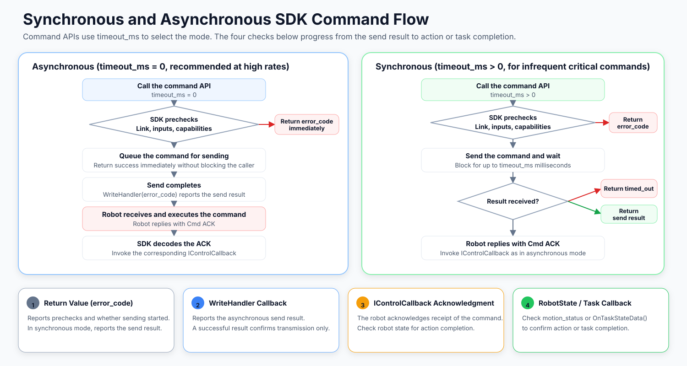

# Genisom L2 SDK API Reference

[Documentation Overview](../index.md) | [SDK Quickstart](./06-sdk-quickstart.md) | [Callbacks, Data Types, and Status](./08-callbacks-data-types-and-status-reference.md) | [Genisom L2 SDK Control Workflow](./09-control-ownership-tasks-and-peripherals.md)

## Core Class

`robot_sdk::SDKClient` is declared in `include/robot_sdk/sdk_client.hpp`. It manages the connection, sends commands, and registers callbacks. Commands return `std::error_code`. State and information queries return their documented types.

Check the installed SDK version with `Version()` and verify compatibility with the robot system before using version-specific APIs. SDK v0.2.3 adds `Walk()` and charging dock pairing APIs and removes `DSB()`. See the [official SDK changelog](https://github.com/zsibot/genisom_robot_sdk/blob/main/CHANGELOG.md) and [headers](https://github.com/zsibot/genisom_robot_sdk/tree/main/include/robot_sdk).



## API Categories

| Section | Topics | Common APIs |
| --- | --- | --- |
| [Connection and Device Information](./07-01-connection-and-device-info.md) | Client construction, connection and disconnection, connection state, version and device information | `SDKClient`, `Connect()`, `GetConnectionState()`, `GetDeviceInfo()` |
| [Robot Control](./07-02-robot-control.md) | Control ownership, software emergency stop, posture and motion commands | `TakeControl()`, `SoftEmergencyStop()`, `StandUp()`, `Move()` |
| [Data Reporting](./07-03-data-reporting.md) | Callback registration, sensor and motion data reporting | `SetDataCallback()`, `SetControlCallback()`, `SetImuConfig()` |
| [Charging Dock and Tasks](./07-04-dock-and-tasks.md) | Bluetooth pairing in the app, recharge and undock tasks, and switching between remote and idle states | `StartRechargeTask()`, `StartUnDockTask()`, `SwitchIdleState()` |
| [Peripherals and Cameras](./07-05-peripherals-and-camera.md) | Fill light, camera bitrate, [camera nodes and topic configuration](./camera-topic-configuration.md), peripheral power, and LED control | `FrontLight()`, `UpdateCameraBitrate()`, `SetPeriphPower()`, `SetLedCommand()` |

## Genisom L2 Series Device Types

| Model or Device Configuration | `DeviceType` | Short Name |
| --- | --- | --- |
| Genisom L2 (point-foot) | `L2F` | L2 |
| Genisom L2-W (wheeled-legged) | `L2` | L2-W |
| Genisom L2-W Ultra | `L2_ULTRA` | L2-W Ultra |
| Point-foot device with surround view | `L2F_ULTRA` | L2F Ultra |

<a id="接口能力表"></a>

## API Support by Model

`✓` means the device type passes the SDK capability check for that API. For `—`, the SDK returns `Errc::UnsupportedDeviceOperation` without sending the command.

### Connection, Information, and Basic Control

<<<<<<< HEAD
| API | Genisom L2 | Genisom L2-W | Genisom L2-W Ultra |
| --- | :---: | :---: | :---: |
| `SDKClient()` / `~SDKClient()` | ✓ | ✓ | ✓ |
| `Connect()` / `Disconnect()` | ✓ | ✓ | ✓ |
| `IsConnected()` / `GetConnectionState()` | ✓ | ✓ | ✓ |
| `SetControlCallback()` / `SetDataCallback()` | ✓ | ✓ | ✓ |
| `Version()` / `ProtocolVersion()` / `SystemVersion()` | ✓ | ✓ | ✓ |
| `GetDeviceInfo()` | ✓ | ✓ | ✓ |
| `SoftEmergencyStop()` | ✓ | ✓ | ✓ |
| `ObstacleAvoidance()` (Obstacle stop) | — | — | — |
| `StandUp()` / `BalanceStandUp()` / `LieDown()` | ✓ | ✓ | ✓ |
| `Stair()` / `Crawl()` / `CrawlWalk()` | ✓ | ✓ | ✓ |
| `Walk()` (v0.2.3) | ✓ | ✓ | ✓ |
| `Climb()` | — | ✓ (v0.2.3) | ✓ (v0.2.3) |
| `PosControl()` / `Locked()` / `SetSpeed()` | ✓ | ✓ | ✓ |
| `Gait()` | — | ✓ | ✓ |
| `Slim()` / `SkWalk()` / `Sand()` | — | — | — |
| `ReverseHeadTail()` | — | — | — |

### Motion, Lights, and Data

| API | Genisom L2 | Genisom L2-W | Genisom L2-W Ultra |
| --- | :---: | :---: | :---: |
| `Move()` / `PosMove()` | ✓ | ✓ | ✓ |
| `MoveVelocity()` | ✓ | ✓ | ✓ |
| `Turn()` / `ControlHead()` / `HighLowStance()` | ✓ | ✓ | ✓ |
| `FrontLight()` / `AutoModeLight()` | ✓ | ✓ | ✓ |
| `BackLight()` | — | — | — |
| `SetImuConfig()` / `SetLuxConfig()` | ✓ | ✓ | ✓ |
| `SetMcConfig()` / `SetSpeedReportConfig()` | ✓ | ✓ | ✓ |
| `SetJointStateConfig()` | ✓ | ✓ | ✓ |
| `UpdateCameraBitrate()` | ✓ | ✓ | ✓ |
=======
| API | Genisom L2 | Genisom L2-W | Genisom L2-W Ultra | L2F Ultra |
| --- | :---: | :---: | :---: | :---: |
| `SDKClient()` / `~SDKClient()` | ✓ | ✓ | ✓ | ✓ |
| `Connect()` / `Disconnect()` | ✓ | ✓ | ✓ | ✓ |
| `IsConnected()` / `GetConnectionState()` | ✓ | ✓ | ✓ | ✓ |
| `SetControlCallback()` / `SetDataCallback()` | ✓ | ✓ | ✓ | ✓ |
| `Version()` / `ProtocolVersion()` / `SystemVersion()` | ✓ | ✓ | ✓ | ✓ |
| `GetDeviceInfo()` | ✓ | ✓ | ✓ | ✓ |
| `SoftEmergencyStop()` | ✓ | ✓ | ✓ | ✓ |
| `StandUp()` / `BalanceStandUp()` / `LieDown()` | ✓ | ✓ | ✓ | ✓ |
| `Stair()` / `Crawl()` / `CrawlWalk()` | ✓ | ✓ | ✓ | ✓ |
| `Climb()` | — | — | — | — |
| `PosControl()` / `Locked()` / `SetSpeed()` | ✓ | ✓ | ✓ | ✓ |
| `Gait()` | — | ✓ | ✓ | — |
| `Slim()` / `DSB()` / `SkWalk()` / `Sand()` | — | — | — | — |
| `ReverseHeadTail()` | — | — | — | — |

### Motion, Lights, and Data

| API | Genisom L2 | Genisom L2-W | Genisom L2-W Ultra | L2F Ultra |
| --- | :---: | :---: | :---: | :---: |
| `Move()` / `PosMove()` | ✓ | ✓ | ✓ | ✓ |
| `Turn()` / `ControlHead()` / `HighLowStance()` | ✓ | ✓ | ✓ | ✓ |
| `FrontLight()` / `AutoModeLight()` | ✓ | ✓ | ✓ | ✓ |
| `BackLight()` / `ObstacleAvoidance()` | — | — | — | — |
| `SetImuConfig()` / `SetLuxConfig()` | ✓ | ✓ | ✓ | ✓ |
| `SetMcConfig()` / `SetSpeedReportConfig()` | ✓ | ✓ | ✓ | ✓ |
| `SetJointStateConfig()` | ✓ | ✓ | ✓ | ✓ |
| `UpdateCameraBitrate()` | ✓ | ✓ | ✓ | ✓ |
>>>>>>> parent of 3731631 (update)

### Control Ownership, Tasks, and Peripherals

| API | Genisom L2 | Genisom L2-W | Genisom L2-W Ultra | L2F Ultra |
| --- | :---: | :---: | :---: | :---: |
| `TakeControl()` / `ReleaseControl()` | ✓ | ✓ | ✓ | ✓ |
| `StartRechargeTask()` / `StopRechargeTask()` | ✓ | ✓ | ✓ | ✓ |
| `StartUnDockTask()` / `StopUnDockTask()` | ✓ | ✓ | ✓ | ✓ |
| `SwitchRemoteState()` / `SwitchIdleState()` | ✓ | ✓ | ✓ | ✓ |
| `SetPeriphPower()` / `GetPeriphPower()` | ✓ | ✓ | ✓ | ✓ |
| `SetLedAutoMode()` / `GetLedAutoMode()` | ✓ | ✓ | ✓ | ✓ |
| `SetLedCommand()` | ✓ | ✓ | ✓ | ✓ |

A supported API can still fail depending on the connection, control ownership, emergency stop status, robot state, parameter ranges, and installed peripherals.

## Common Parameters and Return Values

```cpp
using WriteHandler =
    std::function<void(const std::error_code&, std::size_t)>;
```

| Parameter | Description |
| --- | --- |
| `timeout_ms == 0` | Send asynchronously. `WriteHandler` reports the result. |
| `timeout_ms > 0` | Wait synchronously. The function's return value reports the result. |
| `handler` | Callback for the asynchronous send result |

`WriteHandler` receives an error code and the number of bytes reported written. Read the error code to check the transport result. In asynchronous mode, also check the immediate return value for errors such as invalid parameters, a missing connection, or an unsupported operation. For commands with a device acknowledgment, read the corresponding [callback](./08-callbacks-data-types-and-status-reference.md#icontrolcallback). Confirm physical actions and task completion from state reports.

| Common Error | Meaning |
| --- | --- |
| `std::errc::invalid_argument` | A parameter is out of range or the parameter combination is invalid. |
| `std::errc::not_connected` | No connection has been established. |
| `std::errc::timed_out` | The synchronous wait timed out. |
| `std::errc::operation_in_progress` | The same operation is already in progress. |
| `Errc::ShakeHandFailed` | The handshake failed. |
| `Errc::ProtocolMismatch` | The communication protocol versions do not match. |
| `Errc::ControlledDenial` | Control ownership is currently unavailable. |
| `Errc::ConnectFailed` | The connection failed. |
| `Errc::UnsupportedDeviceOperation` | The current device type does not support this API. |
