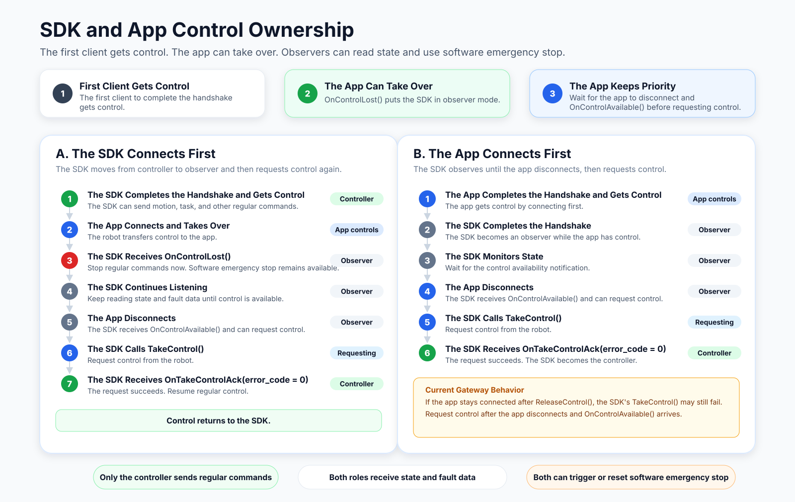

# Genisom L2 Control Ownership, Tasks, and Peripheral Control

[Documentation Overview](../index.md) | [SDK API Reference](./07-sdk-api-reference.md) | [Callbacks, Data Types, and Status](./08-callbacks-data-types-and-status-reference.md) | [Examples and Troubleshooting](./10-examples-and-troubleshooting.md)

## Control Ownership Model

Only one client at a time has regular control of the robot. A client without control ownership can still receive state and fault data. It cannot issue regular posture, motion, task, or device control commands.



### Control Ownership Rules

| Rule | Application Behavior |
| --- | --- |
| The first client completes the handshake | It may acquire control immediately. Check `control_source` to confirm. |
| The app takes over | The SDK receives `OnControlLost()`. Stop sending regular control commands immediately. |
| Control becomes available again | The SDK receives `OnControlAvailable()`. Request control from a worker thread. |
| The request succeeds | `OnTakeControlAck()` reports `error_code == 0`. |
| The application exits | Stop motion before calling `ReleaseControl()`. |

### Control Handover Sequence


### Control Ownership State Transitions


### TakeControl

```cpp
std::error_code TakeControl(
    int timeout_ms = 0, WriteHandler handler = ...);
```

The return value indicates whether the command was sent or the synchronous wait succeeded. Confirm whether the robot granted control through the callback.

```cpp
void OnTakeControlAck(const TakeControlAck& ack) override {
    if (ack.error_code == 0) {
        // Control acquired
    } else {
        // ack.reason gives the reason for failure
    }
}
```

### ReleaseControl

```cpp
std::error_code ReleaseControl(
    int timeout_ms = 0, WriteHandler handler = ...);
```

`OnReleaseControlAck()` reports the result. Release control when the application exits, when switching to the app, or when you do not expect to send control commands for an extended period.

### Recommended Control Sequence

1. Register the data and control callbacks.
2. Connect to the robot and confirm the connection state is `CONNECTED`.
3. Read the emergency stop state, faults, and current control source.
4. Wait for `OnControlAvailable()` or try calling `TakeControl()` directly.
5. Confirm that `OnTakeControlAck()` reports `error_code == 0`.
6. Listen for `OnControlLost()` while controlling the robot.
7. If you lose control, stop the command loop and reset the target velocity to zero.
8. Release control and disconnect before exiting.

## Recharge and Undock Tasks

| API | Function |
| --- | --- |
| `StartRechargeTask()` | Start autonomous recharging |
| `StopRechargeTask()` | Stop the recharge task |
| `StartUnDockTask()` | Start autonomous undocking |
| `StopUnDockTask()` | Stop the undock task |

### Send, Acknowledgment, and Execution Results

| Stage | How to Check | What It Confirms |
| --- | --- | --- |
| Send | Return value or `WriteHandler` | Whether the command was sent |
| Acknowledgment | `OnStartRechargeTask()` or the corresponding callback | Whether the robot acknowledged the command |
| Execution | `OnTaskStateData()` | Whether the task is starting, running, successful, failed, or stopped |

```cpp
void OnTaskStateData(const TaskStateInfo& info) override {
    if (info.task_type == TaskType::RECHARGING) {
        if (info.task_status == TaskStatus::FAILURE) {
            // Log info.error_code and enter the application's safety handling routine
        }
    }
}
```

### Checking Recharge Progress

After starting a recharge task, check the following.

- `task_type == TaskType::RECHARGING`.
- Whether `task_status` changes to `STARTING` or `RUNNING`.
- `RobotState::machine_status == MachineStatus::RECHARGE`.
- Whether `RobotState::charging_pile_connected` becomes `true` after docking.
- Whether the battery status changes to `PowerSupplyStatus::CHARGING`.

A successful return from the API does not confirm that the robot has reached the charging dock or started charging.

### Checking Undock Progress

After starting an undock task, check the following.

- `task_type == TaskType::UNDOCK`.
- Whether `task_status` progresses through `STARTING` and `RUNNING` and reaches `SUCCESS`.
- `RobotState::machine_status == MachineStatus::UNDOCK`.
- Whether the dock connection status clears once the robot has undocked.

### Task Prerequisites and Operating Conditions

- Verify that the charging dock has power, Bluetooth pairing is active, and the map's charging point is valid.
- Align the charging point's orientation with the physical charging dock.
- Keep the cameras and LiDAR clear of obstructions.
- Do not send regular motion commands such as `Move()` during a recharge or undock task.
- If a task fails, record `phase`, `error_code`, the machine state, and the battery state.

## Remote and Idle States

| API | Target State | Acknowledgment |
| --- | --- | --- |
| `SwitchRemoteState()` | `MachineStatus::REMOTE` | `OnSwitchRemote()` |
| `SwitchIdleState()` | `MachineStatus::IDLE` | `OnSwitchIdle()` |

The acknowledgment confirms receipt of the switch command. Check `RobotState::machine_status` for the resulting state.

## Peripheral Power Control

```cpp
struct PowerCtrlCfg {
    PeripheralPower power;
    bool enable;
};

std::error_code SetPeriphPower(
    const PowerCtrlCfg& cfg, int timeout_ms = 0, WriteHandler handler = ...);

std::error_code GetPeriphPower(
    const PowerCtrlCfg& cfg, int timeout_ms = 0, WriteHandler handler = ...);
```

`SetPeriphPower()` controls the protocol power channel. `GetPeriphPower()` queries the channel state. `OnSetPeriphPower()` and `OnGetPeriphPower()` report the respective results.

### Power Safety

- First verify how the protocol channels map to the M12 connector's 24 V output and the M14 connector's VBAT output.
- The M12 connector's 24 V output and the M14 connector's VBAT output each have a total power limit of 100 W. Verify the actual VBAT voltage before connecting a peripheral.
- Check the peripheral's rated voltage, polarity, and startup current, and inspect the cable insulation before enabling power.
- Let the peripheral save its data and shut down normally before disabling the channel.
- After a successful acknowledgment, verify power at the peripheral by checking its state or measuring voltage.
- Do not substitute software switching for fuses, emergency stops, or hardware isolation.

## LED Control

### Automatic and Manual Modes

```cpp
std::error_code SetLedAutoMode(
    bool auto_mode, int timeout_ms = 0, WriteHandler handler = ...);
std::error_code GetLedAutoMode(
    int timeout_ms = 0, WriteHandler handler = ...);
```

In automatic mode, the robot sets the LED effects according to its operating, warning, low-battery, and emergency stop states. In manual mode, the application can call `SetLedCommand()`.

### SetLedCommand

```cpp
struct LedColor {
    uint8_t r, g, b, a;
};

struct LedCommand {
    LedId id;
    LedEffect effect;
    LedColor color;
    uint32_t duration_ms;
};
```

| `LedId` | Meaning |
| --- | --- |
| `ALL` | All LEDs |
| `FRONT` | Front LEDs |
| `BACK` | Rear LEDs |

| `LedEffect` | Meaning |
| --- | --- |
| `OFF` | Off |
| `ON` | Steady on |
| `BREATH` | Pulsing |
| `BLINK` | Blinking |
| `BLINK_TRANSIENT` | Brief blinking |

```cpp
LedCommand cmd{
    LedId::ALL,
    LedEffect::BLINK,
    {255, 128, 0, 255},
    300
};
client.SetLedCommand(cmd, 1000);
```

Restore automatic mode when the manual effect ends so that emergency stop, low-battery, and fault indicators can display normally.

## Shutdown and Error Handling

Stop regular control immediately if any of the following occurs.

- `OnControlLost()` fires.
- The emergency stop state changes to `STOP`.
- A fault with severity `FatalError` or `Error` arrives.
- The connection state leaves `CONNECTED`.
- The task state changes to `FAILURE`.

For normal shutdown, send zero velocity, stop running tasks, restore automatic LED mode, release control, disconnect, and wait for the worker threads to exit.
