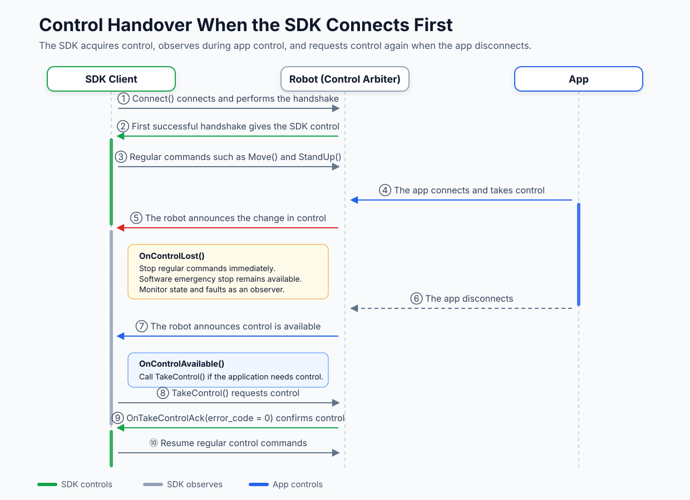
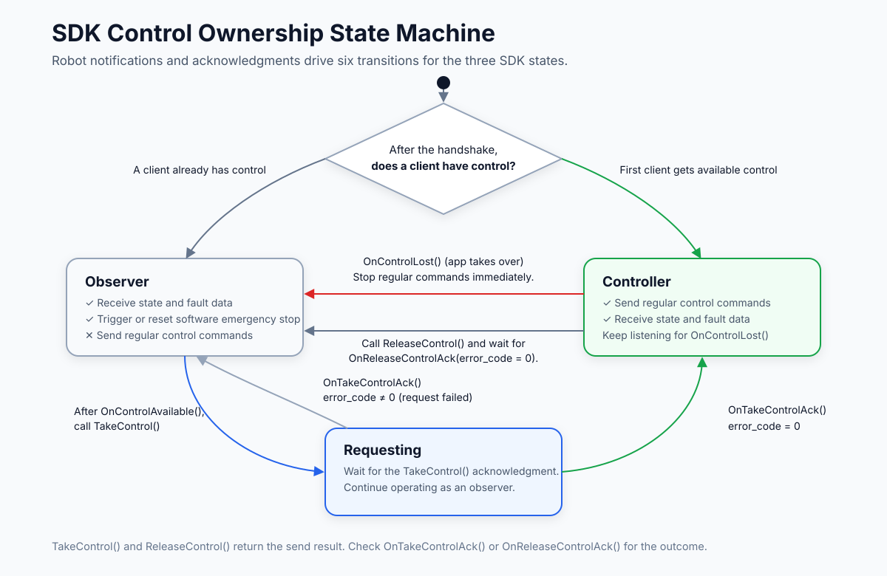

# Genisom L2 SDK Control Workflow

[Documentation Overview](../index.md) | [SDK API Reference](./07-sdk-api-reference.md) | [Callbacks, Data Types, and Status](./08-callbacks-data-types-and-status-reference.md) | [Examples and Troubleshooting](./10-examples-and-troubleshooting.md)

## Control Ownership Model

Only one client at a time has regular control of the robot. A client without control ownership can still receive state and fault data. It cannot issue regular posture, motion, task, or device control commands.


### Control Ownership Rules

| Rule | Application Behavior |
| --- | --- |
| The first client completes the handshake | It may acquire control immediately. Check `control_source` to confirm. |
| The app takes over | The SDK receives `OnControlLost()`. Stop sending regular control commands immediately. |
| Control becomes available again | The SDK receives `OnControlAvailable()`. Request control from a worker thread. |
| The request succeeds | `OnTakeControlAck()` reports `error_code == 0`. |
| The application exits | Stop motion before calling `ReleaseControl()`. |

### Control Handover Sequence



### Control Ownership State Transitions



### TakeControl

```cpp
std::error_code TakeControl(
    int timeout_ms = 0, WriteHandler handler = ...);
```

The return value indicates whether the command was sent or the synchronous wait succeeded. Confirm whether the robot granted control through the callback.

```cpp
void OnTakeControlAck(const TakeControlAck& ack) override {
    if (ack.error_code == 0) {
        // Control acquired
    } else {
        // ack.reason gives the reason for failure
    }
}
```

### ReleaseControl

```cpp
std::error_code ReleaseControl(
    int timeout_ms = 0, WriteHandler handler = ...);
```

`OnReleaseControlAck()` reports the result. Release control when the application exits, when switching to the app, or when you do not expect to send control commands for an extended period.

### Recommended Control Sequence

1. Register the data and control callbacks.
2. Connect to the robot and confirm the connection state is `CONNECTED`.
3. Read the emergency stop state, faults, and current control source.
4. Wait for `OnControlAvailable()` or try calling `TakeControl()` directly.
5. Confirm that `OnTakeControlAck()` reports `error_code == 0`.
6. Listen for `OnControlLost()` while controlling the robot.
7. If you lose control, stop the command loop and reset the target velocity to zero.
8. Release control and disconnect before exiting.

<a id="recharge-and-undock-tasks"></a>

To start a recharge or undock task through the SDK, see [Recharge and Undock Tasks](./07-04-dock-and-tasks.md#recharge-and-undock-tasks).

## Remote and Idle States

| API | Target State | Acknowledgment |
| --- | --- | --- |
| `SwitchRemoteState()` | `MachineStatus::REMOTE` | `OnSwitchRemote()` |
| `SwitchIdleState()` | `MachineStatus::IDLE` | `OnSwitchIdle()` |

The acknowledgment confirms receipt of the switch command. Check `RobotState::machine_status` for the resulting state.

<a id="peripheral-power-control"></a>
<a id="power-safety"></a>

See [Peripheral Power Control](./07-05-peripherals-and-camera.md#peripheral-power-control) for power APIs and safety requirements.

<a id="led-control"></a>
<a id="automatic-and-manual-modes"></a>
<a id="setledcommand"></a>

See [LED Control](./07-05-peripherals-and-camera.md#led-control) for lighting modes and commands.

## Shutdown and Error Handling

Stop regular control immediately if any of the following occurs.

- `OnControlLost()` fires.
- The emergency stop state changes to `STOP`.
- A fault with severity `FatalError` or `Error` arrives.
- The connection state leaves `CONNECTED`.
- The task state changes to `FAILURE`.

For normal shutdown, send zero velocity, stop running tasks, restore automatic LED mode, release control, disconnect, and wait for the worker threads to exit.
