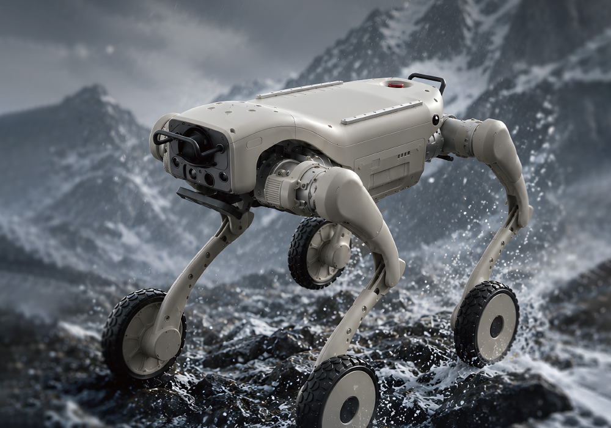

# L2 产品介绍与规格

[返回文档总览](../index.md) | [配件与设备组成](./02-accessories.md) | [硬件接口与系统架构](./03-hardware-interfaces-and-system-architecture.md)

## 产品概述

L2 系列是通用型智能仿生四足机器人，具有负载能力强、续航时间长、防护等级高、运动灵活稳定等特点。L2 采用点足结构，L2-W 和 L2-W Ultra 采用轮足结构，可适应平地、坡道、楼梯等不同作业环境。

机器人集成双目相机、IMU、补光灯等感知设备。L2-W Ultra 进一步配置周视鱼眼相机阵列、工业级 96 线激光雷达、RTK 定位模块、麦克风和扬声器，并提供自主导航、融合避障和全向自主跟随能力。机身预留 USB、M12、M14 和 SIM 卡槽，便于接入上装设备并进行二次开发。

## 系列型号

| 型号 | 足端结构 | 主要能力 |
| --- | --- | --- |
| L2 | 点足 | 复杂地形运动、智能避障、自主跟随和二次开发 |
| L2-W | 轮足 | 轮足高速移动、智能避障、自主跟随和二次开发 |
| L2-W Ultra | 轮足 | 多传感器融合感知、自主导航、融合避障和全向自主跟随 |

## 产品规格

| 分类 | 规格 | L2 | L2-W | L2-W Ultra |
| --- | --- | --- | --- | --- |
| 基础信息 | 站立尺寸（长 × 宽 × 高） | 约 720 × 390 × 480 mm | 约 760 × 450 × 500 mm | 约 760 × 450 × 500 mm |
|  | 趴地尺寸（长 × 宽 × 高） | 约 780 × 460 × 190 mm | 约 780 × 550 × 190 mm | 约 780 × 550 × 190 mm |
|  | 整机重量（含电池） | 约 21 kg | 约 27 kg | 约 27 kg |
|  | 工作温度 | -20 至 55 °C | -20 至 55 °C | -20 至 55 °C |
|  | 防护等级 | IP66 | IP66 | IP66 |
| 性能参数 | 标配算力 | 8 核高性能 CPU | 8 核高性能 CPU | 8 核高性能 CPU + 6 核高性能 CPU（80 TOPS） |
|  | 续航时间 | 5.5 h | 5.5 h | 4.5 h |
|  | 最大速度 | 3.2 m/s | 3.7 m/s | 3.7 m/s |
|  | 极限速度 | 5 m/s | 5 m/s | 5 m/s |
|  | 持续行走负载 | 16 kg | 16 kg | 16 kg |
|  | 连续攀爬楼梯高度 | 22 cm | 25 cm | 25 cm |
|  | 最大攀爬落差高度 | / | 70 cm | 70 cm |
|  | 最大爬坡角度 | 40° | 40° | 40° |
| 关节参数 | 执行器类型 | 高功率密度运动单元 | 高功率密度运动单元 | 高功率密度运动单元 |
|  | 最大关节扭矩 | 95 N·m | 95 N·m | 95 N·m |
|  | 铝合金精密关节电机 | 12 个 | 12 个 | 12 个 |
|  | 高性能轮毂电机 | / | 4 个 | 4 个 |
|  | 关节运动空间 | 机身：-28° 至 28°；大腿：-170° 至 66°；小腿：34.5° 至 156° | 机身：-28° 至 28°；大腿：-170° 至 66°；小腿：34.5° 至 156° | 机身：-28° 至 28°；大腿：-170° 至 66°；小腿：34.5° 至 156° |
| 感知能力 | 相机类型 | 双目相机 | 双目相机 | 前向双目 + 周视鱼眼阵列 |
|  | IMU | 标配 | 标配 | 标配 |
|  | 3D 激光雷达 | / | / | 工业级 96 线激光雷达 × 2 |
|  | RTK 定位模块 | / | / | 标配 |
| 智能决策 | 自主导航 | / | / | 标配 |
|  | 智能避障 | 标配 | 标配 | 激光 + 视觉融合避障 |
|  | 自主跟随 | 标配 | 标配 | GLUE 全向自主跟随 |
| 通信与交互 | Wi-Fi / 蓝牙 | 标配 | 标配 | 标配 |
|  | 4G / 5G | 4G | 4G | 5G |
|  | 补光灯 | 标配 | 标配 | 标配 |
|  | UWB | 标配 | 标配 | 标配 |
|  | 麦克风 / 扬声器 | / | / | 标配 |
|  | 功能拓展接口 | USB 3.0 × 2、M12 17PIN 复合接口 × 1、M14 18PIN 复合接口 × 1、SIM 卡槽 × 1 | USB 3.0 × 2、M12 17PIN 复合接口 × 1、M14 18PIN 复合接口 × 1、SIM 卡槽 × 1 | USB 3.0 × 2、M12 17PIN 复合接口 × 1、M14 18PIN 复合接口 × 1、SIM 卡槽 × 1 |
| 拓展能力 | 实时图像传输 | 标配 | 标配 | 标配 |
|  | OTA 升级 | 标配 | 标配 | 标配 |
|  | 二次开发 | 标配 | 标配 | 标配 |
| 配件 | 电池 | 15000 mAh | 15000 mAh | 15000 mAh |
|  | 适配器 | 标配 | 标配 | 标配 |
|  | 充电座 | 标配 | 标配 | 标配 |
|  | 充电桩（包含自主回充功能） | 可选配 | 可选配 | 可选配 |

## 参数说明

- 续航时间是在速度 1 m/s、无负载工况下测得的实验室数据。
- 极限速度是在无负载、平坦路面的理想工况下测得，实际速度会随负载、地形和温度变化。
- 部分功能与参数基于实验室测试环境，实际表现可能因使用场景和产品配置不同而变化。
- 产品配置和功能会持续迭代，实际外观、接口和功能以交付设备为准。
- 功能拓展接口的电气定义、功率限制和针脚说明见[硬件接口与系统架构](./03-hardware-interfaces-and-system-architecture.md)。
