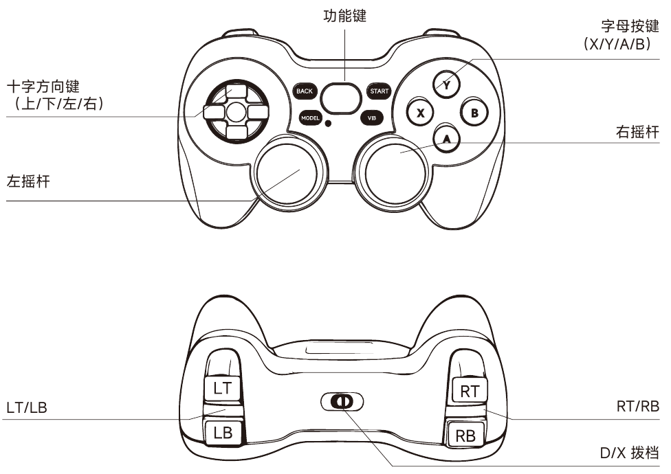

# L2 配件与设备组成

[返回文档总览](../index.md) | [产品介绍与规格](./01-product-introduction-and-specifications.md) | [L2 设备操作与安全使用](./04-device-controller-and-app-guide.md)

## 随箱组成

开箱后应立即对照装箱清单核对物品。如有缺失，请在 7 日内联系售后。L2 和 L2-W 标配无屏遥控器，L2-W Ultra 标配带屏遥控器。仅 L2 标配防滑足底。

| 物品 | 数量 | 用途 |
| --- | ---: | --- |
| 四足机器人本体 | 1 | 运动与计算平台，电池单独计入清单 |
| 电池 | 1 | 机器人供电 |
| 充电座 | 1 | 电池离机充电 |
| 电源适配器 | 1 | 为充电座供电 |
| 电源线 | 1 | 连接交流电源与适配器 |
| 无屏遥控器（L2、L2-W） | 1 | 手动控制与急停 |
| 带屏遥控器（L2-W Ultra） | 1 | 手动控制与急停 |
| 防滑足底 | 4 | L2 点足版使用 |
| [M14、M12 航插调试线](./03-hardware-interfaces-and-system-architecture.md#航插调试线) | 各 1 | 引出以太网、电源和信号 |
| UWB 信标 | 1 | 跟随模式定位 |
| 产品使用说明书 | 1 | 设备操作说明 |
| 快速操作指南 | 1 | 常用流程 |
| 装箱清单 | 1 | 到货核对 |
| 合格证 | 1 | 产品标识 |
| 维修工具配件 | 1 | 基础维护和接口盖拆装 |

## 机器人本体

L2 与 L2-W 的机身结构相同，主要区别为点足和轮足。机身主要部件包括上装导轨、上防撞梁、把手、大腿、小腿、扩展仓、双目相机、补光灯、状态指示灯和电池仓。

L2-W Ultra 增加鱼眼相机、激光雷达、麦克风、扬声器和硬急停。机尾激光雷达可拆卸，以适配不同的上装需求。具体拆卸方法请联系售后。

::: warning 搬运要求
机器人应在关机状态下搬运。托住机身，避免提拉腿部、轮足、相机、雷达或扩展接口。手和衣物应避开髋关节与膝关节。
:::

首次取出和摆放设备的步骤与图示见[开箱与摆放](./11-first-use.md#开箱与摆放)。

## 电池

| 参数 | 数值 |
| --- | --- |
| 类型 | 锂离子电池 |
| 额定容量 | 14 Ah（705.6 Wh） |
| 重量 | 4.5 kg |
| 充电温度 | 0 至 40 °C |
| 放电温度 | -20 至 60 °C |

## 充电座与适配器

| 参数 | 数值 |
| --- | --- |
| 充电座型号 | `HXGCB-01` |
| 充电座额定输入 | 58.8 V DC，10 A |
| 充电座额定输出 | 58.8 V DC，10 A |
| 充电座额定功率 | 588 W |
| 适配器交流输入 | 110 至 240 V AC |
| 充电时间（25 °C） | 约 2 h |

首次装入电池见[安装电池](./11-first-use.md#安装电池)。相关操作见[电量指示](./04-device-controller-and-app-guide.md#电量指示)、[离机充电](./04-device-controller-and-app-guide.md#电池离机充电)和[存放](./12-maintenance.md#存放)。

## 遥控器配置

| 遥控器 | 适用产品 | 外观 |
| --- | --- | --- |
| 无屏遥控器 | L2、L2-W |  |
| G12 带屏遥控器 | L2-W Ultra |  |

遥控器的部件、按键和急停方法见 [L2 设备操作与安全使用](./04-device-controller-and-app-guide.md#遥控器)。App 配网和激活见 [L2 首次使用](./11-first-use.md#安装-genisdog)。

## UWB 信标

UWB 信标用于跟随模式下的目标定位。使用前应确认信标电量、配对状态和佩戴位置，运行过程中保持信标无遮挡。UWB 跟随仍需现场人员观察机器人路径，并随时准备急停。

## 充电桩

充电桩属于选配设备，可提供自主回充。L2-W Ultra 使用智航 Pro 回充前，需要完成充电桩安装、蓝牙配对、地图充电点标记和朝向校准，见 [L2 智航 Pro 软件使用](./05-roamerx-pro-guide.md)。SDK 回充和离桩的前置条件见 [L2 控制权、任务与外设控制](./09-control-ownership-tasks-and-peripherals.md)。

## 到货检查

- 按装箱清单核对本体、电池、充电设备和随箱配件数量。
- 检查机身外壳、关节、足端、相机、雷达和航空接口是否损伤。
- 检查电池是否鼓包、变形、漏液或端子损伤。
- 首次通电前清理关节运动范围，确认硬急停或遥控器急停可用。
- 建议保留原包装至少 3 个月，用于长途运输、返修和存储。运输前关闭机器人并拆出电池。
