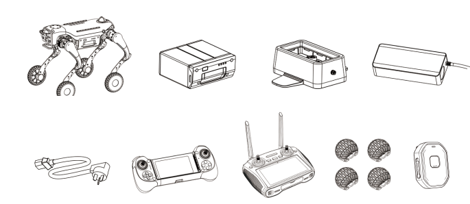
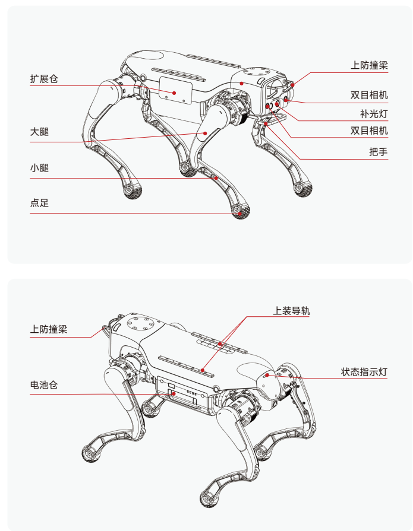
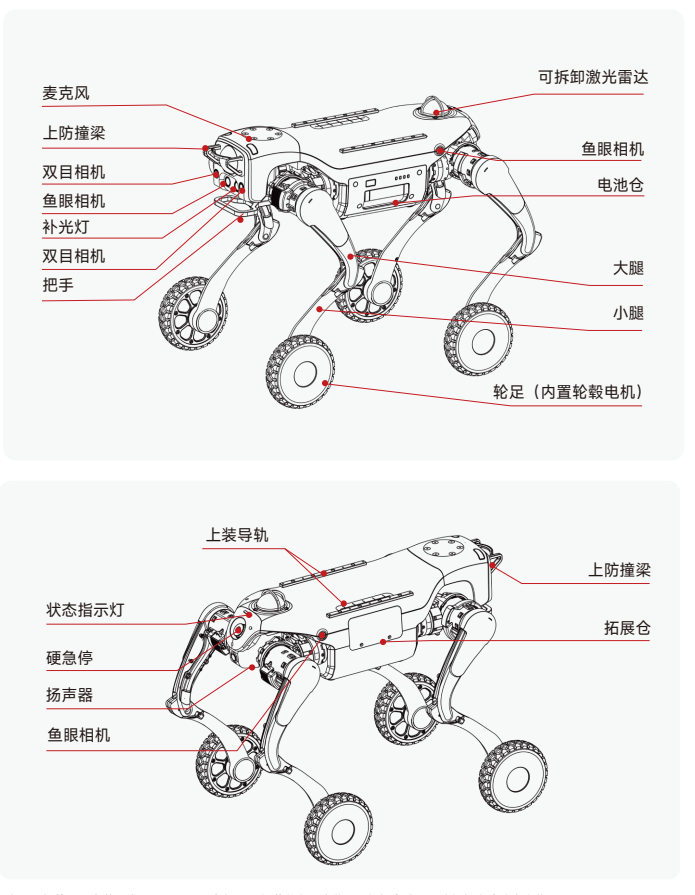
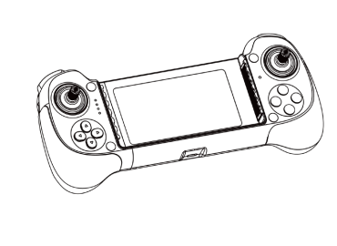
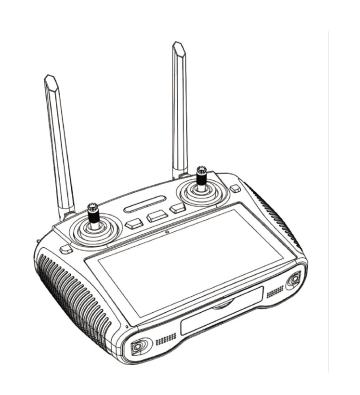

# L2 配件与设备组成

[返回文档总览](../index.md) | [产品介绍与规格](./01-product-introduction-and-specifications.md) | [设备操作、遥控器与 App](./04-device-controller-and-app-guide.md)

## 随箱组成

开箱后应立即对照装箱清单核对物品；如有缺失，应在 7 日内联系售后。

| 物品 | 数量 | 用途 |
| --- | ---: | --- |
| 四足机器人本体 | 1 | 运动与计算平台，不含已拆出的电池 |
| 电池 | 1 | 机器人供电 |
| 充电座 | 1 | 电池离机充电 |
| 电源适配器 | 1 | 为充电座供电 |
| 电源线 | 1 | 连接交流电源与适配器 |
| 遥控器 | 1 | 手动控制与急停 |
| 防滑足底 | 4 | L2 点足版使用 |
| UWB 信标 | 1 | 跟随模式定位 |
| 产品使用说明书 | 1 | 设备操作说明 |
| 快速操作指南 | 1 | 常用流程 |
| 装箱清单 | 1 | 到货核对 |
| 合格证 | 1 | 产品标识 |
| 维修工具配件 | 1 套 | 基础维护和接口盖拆装 |

## 机器人本体

L2 与 L2-W 的机身结构相同，主要区别为点足和轮足。机身主要部件包括上装导轨、上防撞梁、把手、大腿、小腿、扩展仓、双目相机、补光灯、状态指示灯和电池仓。

L2-W Ultra 增加鱼眼相机、可拆卸激光雷达、麦克风、扬声器和硬急停。机尾激光雷达采用可拆卸设计，拆卸前应关闭设备并确认线缆和固定结构已释放。

::: warning 搬运要求
搬运机器人时握持机身把手或托住机身，不得提拉腿部、轮足、相机、雷达和扩展接口。
:::

## 电池

| 参数 | 数值 |
| --- | --- |
| 类型 | 锂离子电池 |
| 额定容量 | 15000 mAh |
| 充电温度 | 0 至 40 °C |
| 放电温度 | -20 至 60 °C |

## 充电座与适配器

| 参数 | 数值 |
| --- | --- |
| 充电座型号 | `HXGCD-01` |
| 额定输入 | 110 至 240 V AC，50/60 Hz |
| 额定输出 | 58.8 V DC，最大 10 A |
| 额定功率 | 600 W |
| 常温充电时间 | 约 2 h |

电池安装、电量判断、充电和存放方法见 [L2 设备操作、遥控器与 App](./04-device-controller-and-app-guide.md)。

## 遥控器配置

| 遥控器 | 适用产品 | 外观 |
| --- | --- | --- |
| 无屏遥控器 | L2、L2-W |  |
| 带屏遥控器 | L2-W Ultra |  |

遥控器的部件名称、按键功能、状态灯和配对方法见 [L2 设备操作、遥控器与 App](./04-device-controller-and-app-guide.md)。

## UWB 信标

UWB 信标用于跟随模式下的目标定位。使用前应确认信标电量、配对状态和佩戴位置，运行过程中保持信标无遮挡。UWB 跟随仍需现场人员观察机器人路径，并随时准备急停。

## 充电桩

充电桩属于选配设备，可用于自主回充和离桩。使用自主回充前，需要完成充电桩安装、蓝牙配对、地图充电点标记和朝向校准。操作流程见 [L2 智航 Pro 软件使用](./05-roamerx-pro-guide.md) 和 [L2 控制权、任务与外设控制](./09-control-ownership-tasks-and-peripherals.md)。

## 到货检查

- 核对本体、遥控器、电池、充电设备和工具数量。
- 检查机身外壳、关节、足端、相机、雷达和航空接口是否损伤。
- 检查电池是否鼓包、变形、漏液或端子损伤。
- 首次通电前清理关节运动范围，确认硬急停或遥控器急停可用。
- 保留包装箱用于运输和返修，运输前关闭机器人并拆出电池。
