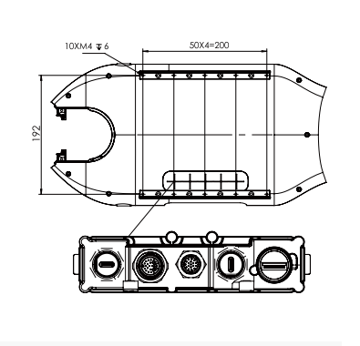
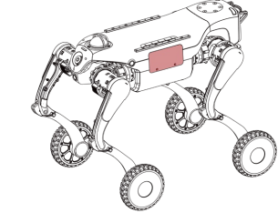
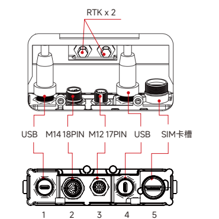
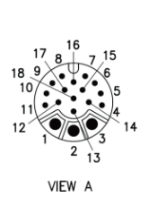
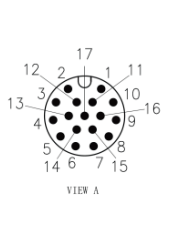
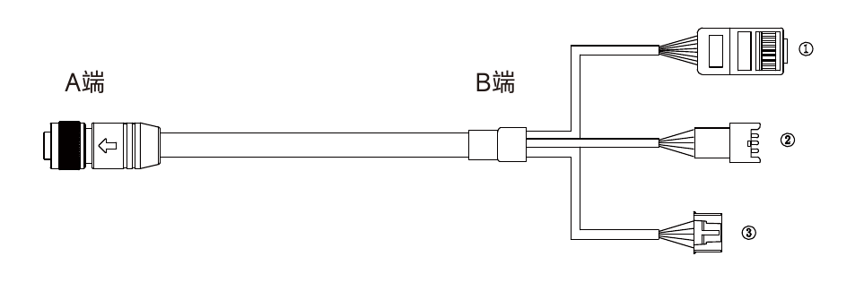
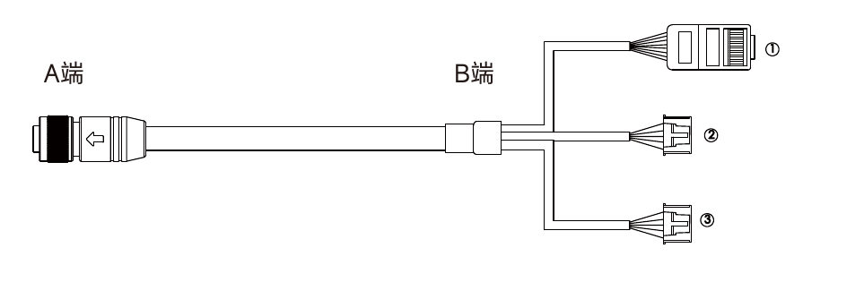

# L2 硬件接口与系统架构

[返回文档总览](../index.md) | [产品介绍与规格](./01-product-introduction-and-specifications.md) | [SDK 快速开始](./06-sdk-quickstart.md)

## 系统组成

L2 开发系统由机器人本体、扩展仓、网络连接、开发主机和 Robot SDK 组成。应用程序运行在 Ubuntu 开发主机上，通过 Wi-Fi 或以太网连接机器人，并调用 `robot_sdk::SDKClient` 发送命令、读取状态和处理回调。

```text
Ubuntu 开发主机
  └─ L2 应用程序
      └─ Robot SDK
          └─ Wi-Fi 或千兆以太网
              └─ L2 机器人控制服务
```

## 上装安装范围

上装安装在机背导轨范围内，可用空间为 210 × 192 × 300 mm，建议上装重量不超过 16 kg。导轨安装孔为 M4 螺纹孔，螺纹有效深度为 6 mm。



规划上装的重心、安装位置、供电、接口和走线后，正式安装前请咨询售后。接入外设前核对工作电压、电流和启动峰值。未使用的航插应安装防护盖。

<a id="exterior-model-downloads"></a>

## 外观模型下载

按设备型号下载对应的 STP 外观模型，在支持 STEP 格式的 CAD 软件中查看外观尺寸、布置上装和核对装配空间。

| 资料 | 用途 | 下载 |
| --- | --- | --- |
| 智身钢镚 L2 外观模型 | 查看 L2 外观尺寸和核对上装空间 | <a href="../assets/downloads/l2-exterior-model.stp" download>下载 STP 模型</a> |
| 智身钢镚 L2-W Ultra 外观模型 | 查看 L2-W Ultra 外观尺寸和核对上装空间 | <a href="../assets/downloads/l2-w-ultra-exterior-model.stp" download>下载 STP 模型</a> |

## 扩展仓与接口位置

扩展仓位于机身侧面。使用配套的 3 mm 内六角螺丝刀依次拆下两颗 M4 螺丝，再取下盖板。接线完成后复位盖板，依次拧紧螺丝。



## 接口功能与参数



| 序号 | 连接器 | 子接口 | 数量 | 说明 |
| ---: | --- | --- | ---: | --- |
| 1、4 | USB 接口 | Type-C | 2 | 输出 5 V、1 A，可连接外部存储设备、摄像头和传感器等 USB 设备 |
| 2 | M14 18PIN | PPS 接口 | 1 | 用于 GNSS 同步、基站同步、多设备协同、上装同步触发、SLAM 地图时间校准和日志同步分析 |
| 2 | M14 18PIN | 以太网口 | 1 | 支持 1000 Mbps 传输，可用于高速数据传输、网络连接、远程监控和上装通信 |
| 2 | M14 18PIN | 电源接口 | 1 | `VBAT` 输出，总功率不高于 100 W |
| 2 | M14 18PIN | RS485 接口 | 1 | 差分串行总线，可连接工业 PLC、外置传感器和执行机构。说明书标注的传输距离不超过 1200 m |
| 3 | M12 17PIN | SBUS 接口 | 1 | 用于连接遥控接收器或其他支持 SBUS 协议的设备 |
| 3 | M12 17PIN | UART 接口 | 1 | 用于连接嵌入式系统、通信设备或其他支持 UART 协议的设备 |
| 3 | M12 17PIN | 以太网口 | 1 | 支持 1000 Mbps 传输，可用于高速数据传输、网络连接、远程监控和上装通信 |
| 3 | M12 17PIN | 电源接口 | 1 | 24 V 输出，总功率不高于 100 W |
| 5 | SIM 卡槽 | 4G/5G 卡槽 | 1 | 用于蜂窝通信，仅支持中国移动、中国联通和中国电信的 SIM 卡 |
| 顶部 | RTK 接口 | RTK | 2 | L2-W Ultra 使用，用于连接 RTK 天线或定位模块 |

## 接线要求

- 接入上装前，先测量实际电压并核对极性。设备启动电流、持续功耗和峰值功耗均应计入供电预算。
- 禁止带电插拔航空插头，禁止将 M12 的 24 V 和 M14 的 `VBAT` 输出并联。
- 两路千兆以太网接入上装设备时，应避免与机器人现有地址冲突。
- UART 的逻辑电平、串口参数和报文格式应与外接设备保持一致。
- 外接 SBUS 控制设备前，应明确控制权优先级和急停路径，防止多个控制端同时下发运动命令。
- RS485 布线宜使用双绞线，并确认总线端接、电平和设备地址。

## 航插线序

::: warning 端面方向与通电检查
下图为机器狗本体的板端航插端面视图。外接线端的端面视图与之镜像。关机后接线，完成线束后逐针检查短路、反接和绝缘，再进行空载通电测试。
:::

### M14 18PIN

| 项目 | 内容 |
| --- | --- |
| 名称 | 18PIN 航插 |
| 板端航插型号 | `STA思大 M14A-18PFM-GP17-CS24044` |
| 板端航插端面 |  |

| 针脚 | 定义 | 针脚 | 定义 |
| ---: | --- | ---: | --- |
| 1 | Vbat | 10 | RS485_B |
| 2 | Vbat | 11 | RS485_A |
| 3 | GND | 12 | GND |
| 4 | PPS | 13 | GND |
| 5 | UART1_TX | 14 | GND |
| 6 | 网口 1 A+ | 15 | 网口 1 C+ |
| 7 | 网口 1 A- | 16 | 网口 1 C- |
| 8 | 网口 1 B+ | 17 | 网口 1 D+ |
| 9 | 网口 1 B- | 18 | 网口 1 D- |

### M12 17PIN

| 项目 | 内容 |
| --- | --- |
| 名称 | 17PIN 航插 |
| 板端航插型号 | `STA思大 3CS24-M12-P17A-GPFM12-CS24044` |
| 板端航插端面 |  |

| 针脚 | 定义 | 针脚 | 定义 |
| ---: | --- | ---: | --- |
| 1 | 网口 2 B+ | 10 | 网口 2 B- |
| 2 | 网口 2 A+ | 11 | 网口 2 D+ |
| 3 | 网口 2 A- | 12 | 网口 2 C+ |
| 4 | UART2_TX | 13 | 网口 2 C- |
| 5 | 24 V | 14 | 24 V |
| 6 | 24 V | 15 | GND |
| 7 | GND | 16 | 网口 2 D- |
| 8 | GND | 17 | `SBUS` |
| 9 | UART2_RX |  |  |

### 航插调试线

M14 和 M12 调试线各一条。A 端接机器狗对应的航插。B 端分为 ① 以太网、② 电源和 ③ 信号三个接口，编号与下表对应。

**M14 18PIN 航插调试线**



**M12 17PIN 航插调试线**



| B 端分支 | M14 航插调试线 | M12 航插调试线 |
| --- | --- | --- |
| ① 以太网 | T-568B | T-568B |
| ② 电源 | 红色 `Vbat`、黑色 `GND` | 红色 24 V、黑色 `GND` |
| ③ 信号 | 橙色 `PPS`、蓝色 `UART_TX`、黄色 `RS485_B`、紫色 `RS485_A`、灰色 `GND` | 黄色 `UART_TX`、蓝色 `UART_RX`、紫色 `SBUS`、灰色 `GND` |

## 上装集成流程

1. 根据尺寸、重量和重心确定安装位置。
2. 核对外设电压、持续功耗和启动峰值，再选择 M12 的 24 V、M14 的 `VBAT` 或 USB 供电。
3. 确认通信接口、电平、线序和带宽。
4. 关机并拆除电池后制作和连接线束。
5. 先不安装运动负载，进行绝缘、短路和空载通电检查。
6. 固定线缆，避开关节运动范围和传感器视野。
7. 低速测试站立、转向、上下坡和急停。

## 硬件安全要求

- 上装高度不超过 300 mm，建议负载不超过 16 kg。
- 扩展接口盖、航空插头防护盖和线缆密封件应安装到位。
- 不得在机器人运动时拆装电池、上装或线束。
- 电源地与信号地的连接方式应在系统设计阶段确认，避免环流和通信干扰。
- 高功率上装需要单独评估热量、保险和故障断电方式。
- 每次改线后先完成静态测试，再开放运动命令。
