# L2 设备操作与安全使用

[返回文档总览](../index.md) | [L2 首次使用](./11-first-use.md) | [配件与设备组成](./02-accessories.md) | [智航 Pro 软件使用](./05-roamerx-pro-guide.md) | [L2 日常维护、存放与故障排查](./12-maintenance.md)

## 使用前检查

- 建议机器人电量在 50% 以上，遥控器电量充足。
- 相机、补光灯和已配备的激光雷达表面清洁、无遮挡。
- 关节活动正常，无异响、卡顿、松动或线缆干涉。
- 电池已锁止，扩展仓盖和未使用的接口防护盖已安装。
- 现场光线充足，路面平整。通道最窄处、上方净空和障碍高度满足机器人通行要求。
- 遥控器急停可用，L2-W Ultra 的硬急停已复位。

::: warning 异常停机与过热
发现关节松动、无法正常站立或运行噪声明显异常时，立即停止使用。待机器人停止运动并稳定后关机，联系售后检修。

低电量时机器人可能因动力不足而突然倒地。执行任务前检查剩余电量。长时间连续运行可能导致关节电机过热，应安排停机休息，避免触碰关节电机的金属表面，以免烫伤。
:::

### 安全距离与人员要求

- 操作员须为已完整阅读并理解产品使用说明书的成年人。操控时保持机器人在视线内，操作员与机器人至少相距 2 m，无关人员至少相距 3 m，运行路径前方 5 m 内应无人员或宠物。
- 无论机器人静止还是运行，都不得将儿童或宠物放在机器人上。运行期间让儿童和宠物远离机器人。
- 遥控器通信距离在空旷场地约为 100 m，在树林、墙体等遮挡场地约为 20 m。根据现场条件缩短距离，避免断联。
- 机器人通过楼梯或斜坡时，人员应远离行走轨迹、下方的楼梯、平台和坡道。斜坡或不平整路面需降低速度并避免快速转向。在较陡的坡面上应避免直接转弯。

## 使用环境

机器人工作温度为 -20 至 55 °C，建议在海拔 2,000 m 以下使用。避免大雾、雷雨、沙暴、大风等恶劣天气，以及玻璃或冰面等光滑路面。

禁止在强电磁干扰或强 Wi-Fi、2.4 GHz 无线干扰区域，悬崖边缘、未防护高台、台阶过密区，湿滑地面，易燃易爆区域，河流、湖泊、泳池等水域附近，以及复杂粉尘环境中使用。

机器人本体的防护等级为 IP66，可防尘和任意方向的低压喷水。雨天或溅水环境下作业前，确认机身无破损、扩展接口盖已盖好、电池与电池仓均干燥。严禁浸水或在积水超过机身底部的环境中使用。作业后请擦干机身，确认电池仓和接口区域干燥后再开盖、充电或继续操作。

## 安装电池

电池插入和锁止确认步骤见[安装电池](./11-first-use.md#安装电池)。

### 电量指示

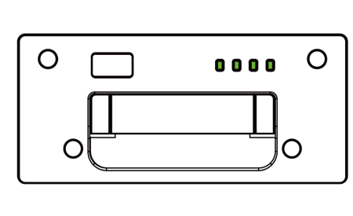

| 指示灯 | 电量或状态 |
| --- | --- |
| 4 颗常亮 | 75%-100% |
| 前 3 颗常亮 | 50%-75% |
| 前 2 颗常亮 | 25%-50% |
| 第 1 颗常亮 | 0%-25% |
| 第 1 颗闪烁 | 0% |
| 4 颗依次点亮 | 正在充电，充满后 4 颗常亮 |

## 开机与关机

### 开机

电源键操作和开机完成判据见[开机步骤](./11-first-use.md#开机)。

### 关机

::: warning 关机前
严禁在运动过程中拔出电池或强制关机，以免机器人摔倒或损坏关节电机。
:::

1. 停止移动命令。
2. 通过遥控器或 App 让机器人进入阻尼趴卧状态。
3. 等待机体稳定。
4. 长按电池电源键 5 秒，确认电源指示灯熄灭。

## 遥控器

L2、L2-W 标配无屏遥控器，L2-W Ultra 标配 G12 带屏遥控器。

### 无屏遥控器

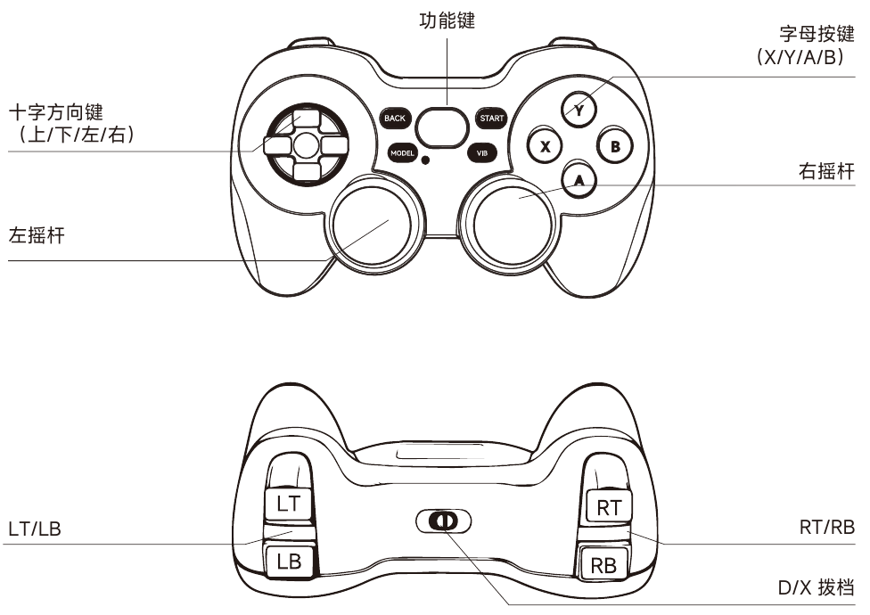

| 适用模式 | 功能 | 操作 |
| --- | --- | --- |
| 运动模式 | 前后左右移动 | 左摇杆前后左右推动 |
| 运动模式 | 左右转弯 | 右摇杆左右推动 |
| 原地模式 | 左右探头 | 右摇杆左右推动 |
| 原地模式 | 机身俯仰 | 右摇杆上推俯身，下推仰身 |
| 原地模式 | 水平左转或右转 | 十字方向键左或右 |
| 原地模式 | 抬高或降低机身 | 十字方向键上或下 |
| 通用 | 站立 | 短按 `Y` |
| 通用 | 阻尼 | 短按 `A` |
| 通用 | 匍匐 | 短按 `X` |
| 通用 | 开关补光灯 | 短按 `B` |
| 运动模式 | 向上跳 | `LB + Y` |
| 运动模式 | 向前跳 | `LB + B` |
| 通用 | 触发或解除急停 | 同时短按 `LB + RB` |
| 原地模式、运动模式 | 在原地与运动模式之间切换 | 短按 `START` |
| 登阶 | 开关登阶姿态 | `LB + START` |
| 沙地（仅轮足） | 开关沙地姿态 | `RB + START` |
| 运动模式 | 在低、中、高速档之间循环 | 短按 `BACK`，振动 1、2、3 次分别对应低、中、高档 |

打开遥控器电池仓，装入两节 AA（5 号）电池并确认安装到位。

::: warning 无屏遥控器使用注意事项
- 使用时将 `D/X` 拨档保持在 `X` 端。若误拨，拨回 `X` 后重启机器人。避免随意操作 `MODE` 和 `VIB` 键，以免影响按键功能。
- 遥控器断连或关机后，机器人可能短时间延续动作或延迟停止。请保持安全距离，留意周围环境。
- 仅在 L2、L2-W 空载时使用向上跳和向前跳。严禁在承载负载时跳跃。
:::

### 带屏遥控器

| 序号 | 部件 | 序号 | 部件 |
| ---: | --- | ---: | --- |
| 1 | 2.4G/5.8G 天线 | 11 | 波轮 G |
| 2 | C 键 | 12 | 三段开关 E |
| 3 | 左摇杆 | 13 | PPM 输出接口 |
| 4 | A 键 | 14 | 升级接口 |
| 5 | 电源键 | 15 | 波轮 H |
| 6 | B 键 | 16 | 三段开关 F |
| 7 | 右摇杆 | 17 | 遥控器提手 |
| 8 | D 键 | 18 | 扬声器 |
| 9 | 触摸显示屏 | 19 | Type-C 充电口 |
| 10 | 麦克风 | 20 | SIM 卡槽 |

| 操作 | 功能 | 适用状态 |
| --- | --- | --- |
| 推动左摇杆 | 前后左右移动 | 运动模式 |
| 推动右摇杆 | 原地转弯 | 运动模式 |
| 同时推动左、右摇杆 | 运动时转向 | 运动模式 |
| 右摇杆左右推动 | 左右探头 | 原地模式 |
| 右摇杆上下推动 | 机身俯仰 | 原地模式 |
| 同时短按 `C + D` | 软件急停 | 通用 |
| 短按 `A` | 开关补光灯 | 通用 |
| 长按电源键 3 秒 | 遥控器开关机 | 通用 |

首次使用前为带屏遥控器充满电。使用配套 Type-C 数据线和原装适配器接入电源。充电时电量指示灯呈呼吸状态，亮起的 LED 数表示当前电量，充满后指示灯常亮。

## 运动模式

在 GenisDog 主页面点击顶部的当前模式，再从展开的列表中选择所需模式。无屏遥控器的模式和速度切换方式见[无屏遥控器](#无屏遥控器)。

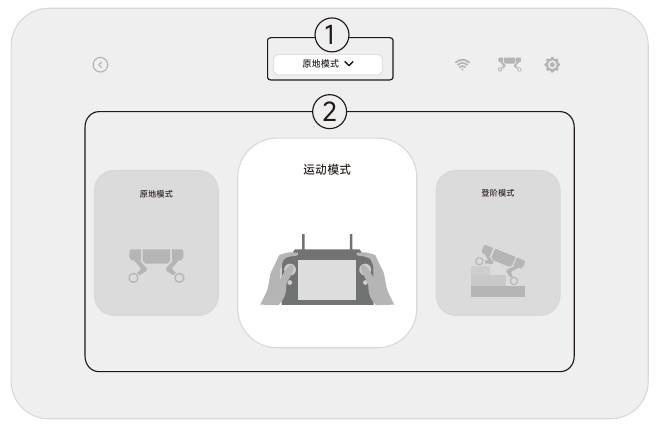

| 模式 | 用途 |
| --- | --- |
| 原地模式 | 保持原地，执行机身旋转、俯仰和高低调整 |
| 运动模式 | 平地和一般复杂地形移动 |
| 登阶模式 | 多级楼梯和台阶移动 |
| 跟随模式 | 基于 UWB 定位信号跟随移动目标 |

在运动模式下，点击主页面左侧的当前速度档位，再使用展开的滑块调整档位。

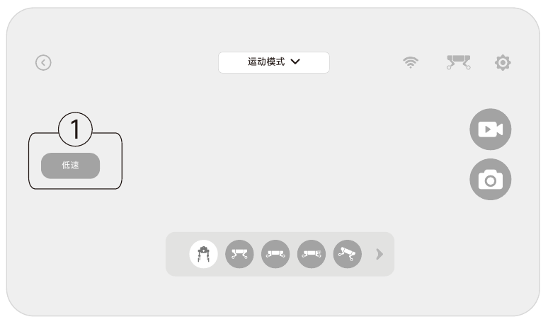

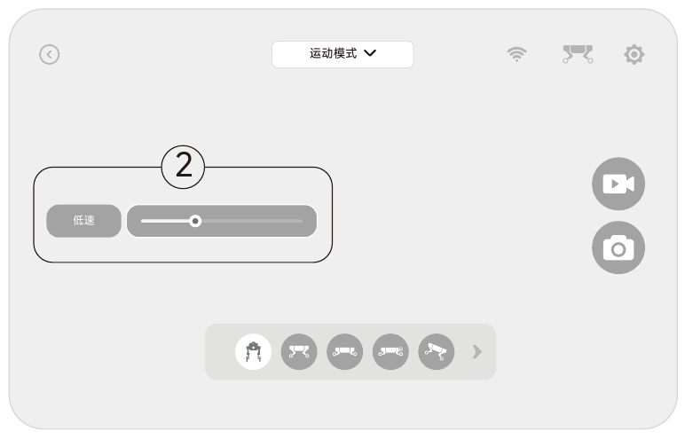

各档位的空载最高速度如下。

| 档位 | 最高速度 | 场景 |
| --- | ---: | --- |
| 低速 | 1.0 m/s | 室内、新手练习 |
| 中速 | 2.0 m/s | 一般户外 |
| 高速 | 点足 3.0 m/s，轮足 3.7 m/s | 平整、开阔、无人区域 |

高速档运行时，选择开阔且无人经过的区域，防止高速碰撞。

## 急停

::: warning 急停解除条件
出现腿部乱摆、机身剧烈晃动等异常时，应立即触发急停。解除急停前先排除故障并确认关节周围无人。
:::

### 硬急停

L2-W Ultra 配有机身硬急停。按下后机器人立即停止运动并趴卧。解除时按按钮箭头方向旋转复位。

### 遥控器急停

L2、L2-W 无机身硬急停，现场通过无屏遥控器触发急停。

- L2、L2-W 无屏遥控器同时短按 `LB + RB` 触发急停。排除故障并确认关节周围无人后，再同时短按 `LB + RB` 解除急停。
- L2-W Ultra 带屏遥控器同时短按 `C + D` 触发急停。

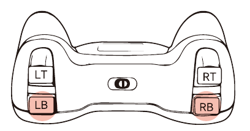

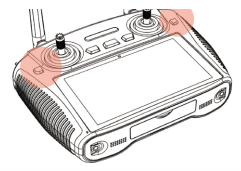

### SDK 软件急停 {#软件急停}

通过 SDK 调用 [`SoftEmergencyStop(true)`](./07-02-robot-control.md#softemergencystop) 触发软件急停。现场操作时应确保所用型号的遥控器急停可用，使用 L2-W Ultra 时也应确认机身硬急停可用。

## 状态指示灯

| 颜色和灯效 | 状态 |
| --- | --- |
| 白灯慢闪 | 开机中 |
| 白灯常亮 | 手动控制或工作状态 |
| 白灯呼吸 | 待机 |
| 绿灯慢闪 | 定位中或自动回程中 |
| 绿灯常亮 | 自动任务执行中 |
| 黄灯快闪 | 告警 |
| 黄灯常亮 | 低电量 |
| 红灯快闪 | 故障 |
| 红灯常亮 | 急停 |
| 蓝灯常亮 | 升级中 |
| 呼吸灯 | 通过选配充电桩充电中 |

L2-W Ultra 的机身急停按钮还带有独立指示灯。熄灭表示机身急停未触发，红灯常亮表示机身急停已触发。

## 连接 App

GenisDog 安装、蓝牙连接、配网和首次激活的步骤与图示见 [L2 首次使用](./11-first-use.md#安装-genisdog)。

### 切换连接方式

在 App 主页面点击设置图标，进入「连接」或「配网」。

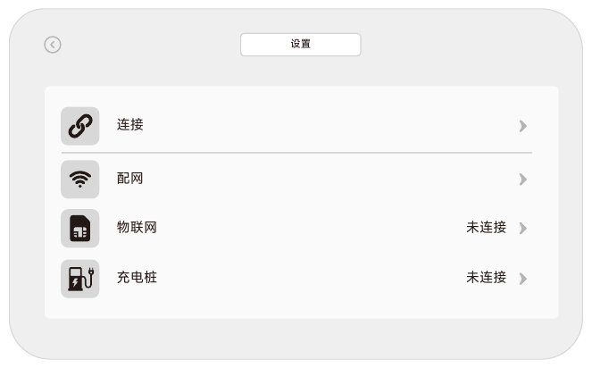

- 从 Wi-Fi 切换到 AP 时，按提示断开 Wi-Fi，再连接机器人热点。
- 从 AP 切换到 Wi-Fi 时，选择 Wi-Fi 配网，按提示输入网络信息。联网成功后自动切换。

配网和切换时，将手机或带屏遥控器靠近机器人，保持蓝牙连接。日常控制使用已选的连接方式，配网后断开蓝牙不影响正常操控。升级固件等需要联网的操作应保持机器人联网。按钮名称随 App 版本迭代可能变化，以当前界面为准。

### 拍照与录像

在主控页点击右侧的相机图标拍照，或点击录像图标录像。

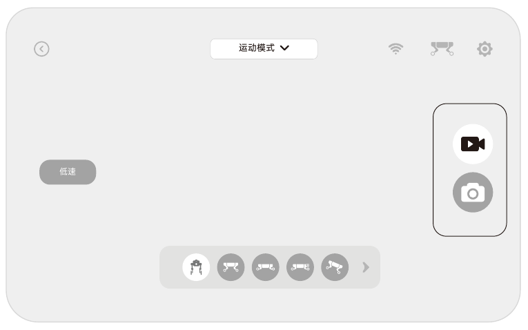

拍摄完成后，在「设置」中打开「相册」查看。

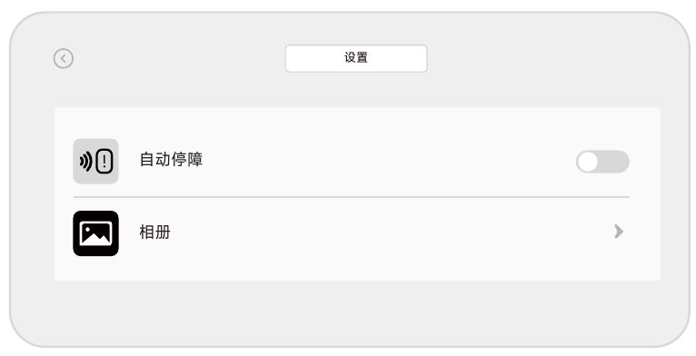

### UWB 配对与跟随

1. 在主控页选择「跟随模式」。

   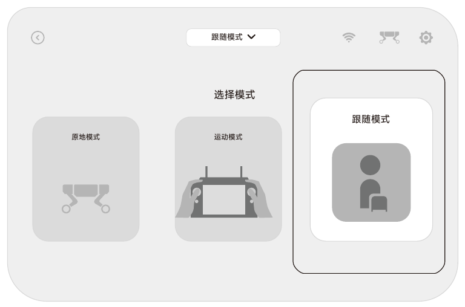

2. 若提示 UWB 未连接，点击「前往配对」并按 App 提示操作。

   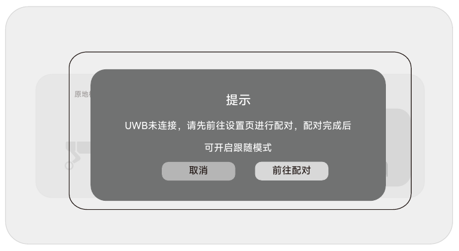

3. 配对时让 UWB 信标与机器人保持在 3 m 以内，点击「开始配对」。配对完成后可开启跟随模式。

   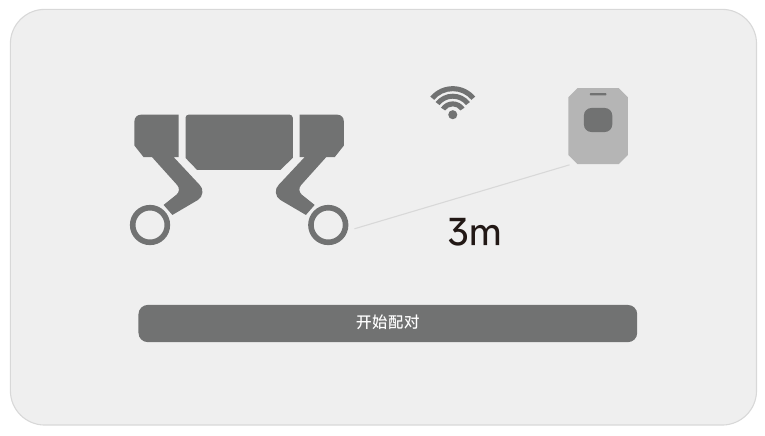

机器人本体电量低于 20% 时无法使用该功能。使用跟随模式时，保持机器人在视线内，留意行进路线，随时准备急停。

## 充电桩配对

安装选配充电桩后，在 GenisDog 的「设置」中进入「充电桩」，按 App 提示完成蓝牙配对。完整步骤和截图见 [L2 充电桩与任务](./07-04-dock-and-tasks.md#充电桩配对)。

## 充电

### 电池与电源安全

- 使用与设备匹配的原装电池。禁止拆解电池组或引出电池极片使用。废旧电池应交给专业回收机构处理。
- 适配器仅限室内使用，充电座应远离热源。电源线损坏时应停用，使用专用电源线或由制造商、维修部门提供的专用组件更换。
- 如果漏出的电解液进入眼睛，不要揉眼。立即用大量清水冲洗眼睛，冲洗后尽快就医。

### 电池离机充电

::: warning 充电环境与设备
充电应在通风、干燥、0 至 40 °C 的环境中进行。请使用完好的官方原装充电座、适配器和电源线。禁止覆盖充电座或电池，禁止在易燃物附近充电，电池充电时间不得超过 24 小时。

充电时避免触摸发热的适配器。若电池出现异味、冒烟、变形等异常，立即切断充电电源，停止使用并联系售后。
:::

1. 将电源适配器连接到充电座，再接入 110 至 240 V AC 电源。
2. 让机器人进入阻尼趴卧状态，长按电池电源键 5 秒关机。
3. 握住电池拉带，取出电池。
4. 将电池插入充电座。充电时电量灯依次点亮，充满后 4 颗常亮。
5. 充满后断开交流电源，再取出电池。

### 自主回充

L2-W Ultra 安装选配充电桩并[完成配对](#充电桩配对)后，可在[智航 Pro 中配置充电点和启动自主回充](./05-roamerx-pro-guide.md#自主回充与出桩)。通过 SDK 启动回充时，应结合充电点、充电桩连接状态和任务状态回调判断是否完成，详见 [SDK 回充与离桩任务](./07-04-dock-and-tasks.md#回充与离桩任务)。

维护设备或排查异常时，参阅 [L2 日常维护、存放与故障排查](./12-maintenance.md)。
