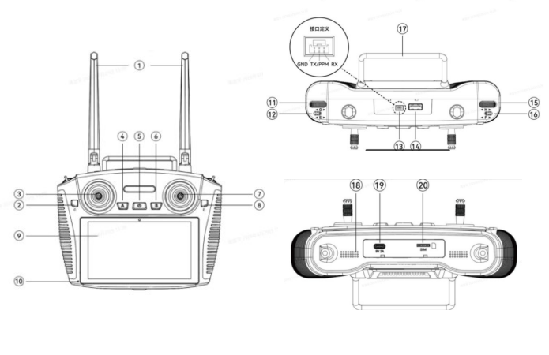
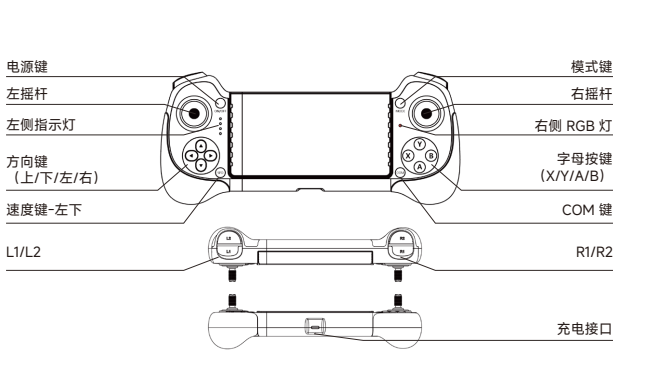
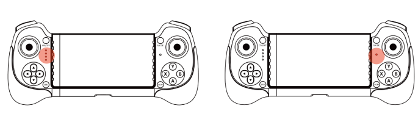
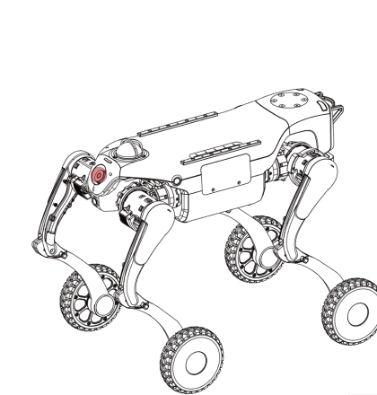
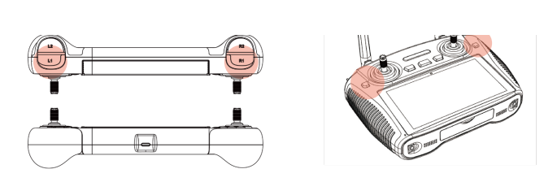
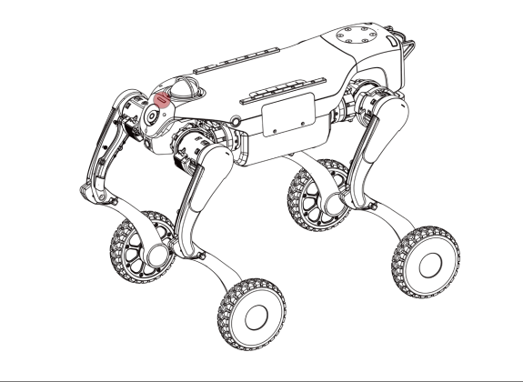

# L2 设备操作、遥控器与 App

[返回文档总览](../index.md) | [配件与设备组成](./02-accessories.md) | [智航 Pro 软件使用](./05-roamerx-pro-guide.md)

## 使用前检查

- 机器人和遥控器电量建议均不低于 50%。
- 相机、激光雷达和补光灯表面清洁、无遮挡。
- 关节活动正常，无异响、卡顿、松动或线缆干涉。
- 电池已锁止，扩展仓盖和未使用的接口防护盖已安装。
- 机器人周围至少预留 2 m，运行路径前方 5 m 内无人和宠物。
- 遥控器急停可用，L2-W Ultra 的硬急停已复位。

## 使用环境

机器人工作温度为 -20 至 55 °C。避免在冰面、镜面石材、油污地面、悬崖边缘、未防护高台、强电磁干扰、易燃易爆区域或深水区域运行。

IP66 可防尘和低压喷水，但不支持浸水。雨天作业后应擦干机身，确认电池仓和接口区域无积水后再充电或开盖。

## 安装电池

1. 将机器人置于自然趴卧姿态并保持关机。
2. 按电池和电池仓方向标识插入电池。
3. 推至完全卡入，确认锁止声音和机械位置。
4. 短按电池电源键，检查电量指示灯。

### 电量指示

| 指示灯 | 电量或状态 |
| --- | --- |
| 4 颗常亮 | 75%-100% |
| 前 3 颗常亮 | 50%-75% |
| 前 2 颗常亮 | 25%-50% |
| 第 1 颗常亮 | 0%-25% |
| 第 1 颗闪烁 | 电量耗尽 |
| 4 颗依次点亮 | 正在充电；充满后 4 颗常亮 |

## 开机与关机

### 开机

1. 确认机器人自然趴卧，周围无人员和障碍物。
2. 短按一次电池电源键。
3. 再长按电源键约 5 秒。
4. 等待状态指示灯完成开机过程。

### 关机

::: warning 关机前
禁止在运动过程中拔出电池或强制关机。
:::

1. 停止移动命令。
2. 通过遥控器或 App 让机器人进入阻尼趴卧状态。
3. 等待机体稳定。
4. 长按电池电源键约 5 秒，确认指示灯熄灭。

## 遥控器

L2 和 L2-W 配套无屏遥控器，L2-W Ultra 配套带屏遥控器。

### 带屏遥控器

| 序号 | 部件 | 序号 | 部件 |
| ---: | --- | ---: | --- |
| 1 | 2.4G/5.8G 天线 | 11 | 波轮 G |
| 2 | C 键 | 12 | 三段开关 E |
| 3 | 左摇杆 | 13 | PPM 输出接口 |
| 4 | A 键 | 14 | 升级接口 |
| 5 | 电源键 | 15 | 波轮 H |
| 6 | B 键 | 16 | 三段开关 F |
| 7 | 右摇杆 | 17 | 遥控器提手 |
| 8 | D 键 | 18 | 扬声器 |
| 9 | 触摸显示屏 | 19 | Type-C 充电口 |
| 10 | 麦克风 | 20 | SIM 卡槽 |

| 操作 | 功能 | 适用状态 |
| --- | --- | --- |
| 推动左摇杆 | 前后左右移动 | 运动模式 |
| 推动右摇杆 | 原地转弯 | 运动模式 |
| 左右同时推动两摇杆 | 运动时转向 | 运动模式 |
| 右摇杆左右推动 | 左右探头 | 原地模式 |
| 右摇杆上下推动 | 机身俯仰 | 原地模式 |
| 同时短按 `C + D` | 软件急停 | 通用 |
| 短按 `A` | 开关补光灯 | 通用 |
| 长按电源键 3 秒 | 遥控器开关机 | 通用 |

### 无屏遥控器

| 操作 | 功能 |
| --- | --- |
| 长按 `COM` 3 秒 | LoRa 日常配对 |
| 同时按 `L1 + COM` | 蓝牙配对 |
| 长按电源键 3 秒 | 开机或关机 |
| 短按 `Mode` | 原地模式与运动模式切换 |
| 同时按 `L1 + Mode` | 跟随模式 |
| 同时按 `L2 + Mode` | 登阶模式 |
| 短按 `Speed` | 速度档位切换 |
| 短按 `Y` | 站立 |
| 短按 `A` | 阻尼趴卧 |
| 短按 `X` | 匍匐 |
| 短按 `B` | 补光灯开关 |
| 方向键左右 | 机身水平转动 |
| 方向键上下 | 高低身形 |
| 右摇杆左右 | 左右探头 |
| 右摇杆上下 | 机身俯仰 |
| 左摇杆 | 前后左右移动 |
| 右摇杆左右 | 转向 |
| 同时按 `L1 + Y` | 向上跳 |
| 同时按 `L1 + B` | 向前跳 |
| 同时按 `L1 + R1` | 软件急停 |

高档位只在平整开阔场地使用。

### 无屏遥控器状态灯

左右两侧指示灯分别位于遥控器正面两侧：

左侧电量灯：

| 灯效 | 电量或状态 |
| --- | --- |
| 4 颗 LED 亮 | 75%-100% |
| 3 颗 LED 亮 | 50%-75% |
| 2 颗 LED 亮 | 25%-50% |
| 1 颗 LED 亮 | 低于 25% |
| 慢闪 | 电量低，应立即充电 |
| 快闪 | 充电异常 |
| 呼吸 | 正在充电，亮起的 LED 数量表示当前剩余电量 |

右侧 RGB 状态灯：

| 灯效 | 状态 |
| --- | --- |
| 绿灯常亮 | 原地模式 |
| 蓝灯常亮 | 运动模式 |
| 熄灭 | 待机 |
| 蓝灯呼吸 | LoRa 配对中 |
| 蓝灯常亮 3 秒后恢复模式颜色 | LoRa 配对成功 |
| 蓝灯间歇闪烁 | 断连或信号弱 |
| 红灯快闪 | 遥控器异常 |

充电时遥控器按键无法使用；遥控器振动提示后应及时充电。跳跃动作执行前，确认机器人周围 2 m 内无人和障碍物。

## 运动模式

| 模式 | 用途 |
| --- | --- |
| 原地模式 | 保持原地，执行机身旋转、俯仰和高低调整 |
| 运动模式 | 平地和一般复杂地形移动 |
| 登阶模式 | 多级楼梯和台阶移动 |
| 跟随模式 | 基于 UWB 定位信号跟随移动目标 |

速度档位建议：

| 档位 | 速度 | 场景 |
| --- | ---: | --- |
| 低速 | 1.0 m/s | 室内、新手调试、载荷测试 |
| 中速 | 2.0 m/s | 一般户外 |
| 高速 | 点足最高 3.2 m/s，轮足最高 3.7 m/s | 平整、开阔、无人区域 |

## 急停

::: warning 急停解除条件
解除急停前先排除故障并确认关节周围无人。软件急停不能代替硬急停。
:::

### 硬急停

L2-W Ultra 配有机身硬急停。按下后机器人停止运动并趴卧；解除时按按钮箭头方向旋转复位。

### 软件急停

- 带屏遥控器：同时短按 `C + D`。
- 无屏遥控器：同时按 `L1 + R1`。
- SDK：调用 `SoftEmergencyStop(true)`。

## 状态指示灯

| 颜色和灯效 | 状态 |
| --- | --- |
| 白灯慢闪 | 开机中 |
| 白灯常亮 | 手动控制或工作状态 |
| 白灯呼吸 | 待机 |
| 绿灯慢闪 | 定位中或自动回程中 |
| 绿灯常亮 | 自动任务执行中 |
| 黄灯快闪 | 告警 |
| 黄灯常亮 | 低电量 |
| 红灯快闪 | 故障 |
| 红灯常亮 | 急停 |
| 蓝灯常亮 | 升级中 |
| 呼吸灯 | 充电中 |

## 连接 App

### 无屏遥控器

遥控器出厂配对后，机器人和遥控器开机即可自动连接。首次更换遥控器时，长按 `COM` 3 秒执行 LoRa 配对。

### 带屏遥控器

1. 打开“添加机器狗”。
2. 选择 AP 直连模式。
3. 从热点列表选择 `L2-xxxxx`。
4. 输入热点密码并连接。
5. 进入控制页面，确认视频和移动控制正常。

## 充电

### 电池离机充电

::: warning 充电环境与设备
充电应在通风、干燥、0 至 40 °C 的环境中进行。只能使用配套充电座、适配器和电源线，禁止覆盖充电座或电池，禁止在易燃物附近充电。
:::

1. 让机器人进入阻尼并关机。
2. 取出电池。
3. 连接适配器、充电座和交流电源。
4. 将电池插入充电座并检查流水灯。
5. 充满后先断开交流电源，再取出电池。

### 自主回充

安装充电桩后，可通过智航 Pro 或 SDK 启动回充任务。任务必须结合充电点、充电桩连接状态和任务状态回调判断，不能只根据接口返回值判断已完成。

## 日常维护

- 使用干燥软布擦拭机身和充电极片。
- 用镜头布或气吹清洁相机、鱼眼镜头和激光雷达。
- 用软毛刷清理关节缝隙，不向关节喷油或液体。
- 每次使用前检查紧固件、足底或轮胎、接口盖和线束。
- 长期存放时关闭机器人和遥控器，将电池保持在 50%-60%，并至少每 3 个月补充一次电。
