# L2 智航 Pro 软件使用

[返回文档总览](../index.md) | [设备操作、遥控器与 App](./04-device-controller-and-app-guide.md) | [控制权、任务与外设控制](./09-control-ownership-tasks-and-peripherals.md)

## 功能范围

智航 Pro 提供可视化建图、定位、地图编辑、路网规划、巡航任务、自主避障、自主回充和巡航记录。基本流程如下：

```text
网络配置
  → 建图
  → 地图编辑与路网编辑
  → 巡航路径设置
  → 任务下发
  → 巡航监控
  → 任务结束或自主回充
```

## 运行条件

| 项目 | 要求 |
| --- | --- |
| 场景 | 室内或室外单层结构化环境 |
| 地面 | 水泥、沥青、地毯、亚光瓷砖等硬质平坦地面 |
| 建图里程 | 单张地图小于 1 km |
| 建图速度 | 建议约 0.6 m/s，不超过 1 m/s |
| 巡航速度 | 不超过 1 m/s，安防巡逻建议 0.6 m/s |
| 通行宽度 | 大于机器人本体宽度加 60 cm |
| App 距离 | 建议 Wi-Fi 连接距离约 10 m 内 |
| 室外光照 | 建议不低于 10,000 lux |
| 小雨条件 | 降雨量小于 2.5 mm/h，地面无积水 |
| 积雪 | 深度不超过 5 mm |

玻璃墙、长距离无特征走廊、高反光地面、连续台阶和大量动态人员会降低建图、定位和避障稳定性。

## 网络配置

1. 启动机器人和带屏遥控终端。
2. 连接机器人热点。
3. 打开智航 Pro App，进入设置。
4. 选择 L2 设备类型。
5. 关闭并重新启动 App。
6. 确认主页显示视频流，测试低速前后左右移动。

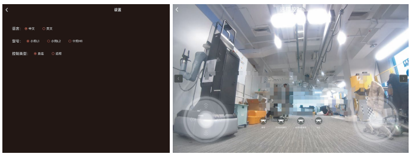

## App 主界面

| 区域 | 功能 |
| --- | --- |
| 地图显示区 | 显示建图轨迹、2D 地图、机器人位置和巡航轨迹 |
| 实时视频窗 | 显示机器人前方视频，用于第一视角观察 |
| 控制区 | 手动移动、急停、暂停和任务控制 |
| 地图模块 | 地图管理、路网编辑和路径管理 |

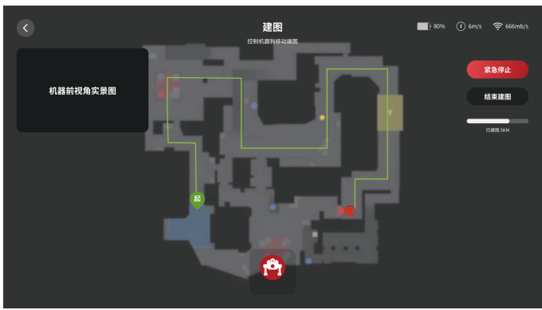

## 建图

### 建图前

- 熟悉现场并规划回环路线，打开任务区域内需要通过的门。
- 清理临时杂物，减少人员和大型移动物体。
- 选择环境特征丰富的起点，机器人保持静止并处于站立姿态。
- 操作人员位于机器人侧面 3 m 内，不站在正前方或正后方。
- 建图阶段不使用 RTK。

### 创建地图

1. 在控制面板点击“MAP”。
2. 进入地图管理，点击“新建地图”。
3. 满足电量和环境条件后点击“开始建图”。
4. 使用虚拟摇杆以约 0.6 m/s 平稳移动。
5. 沿规划路线形成闭环，回到起点附近并沿原路线重合至少 15 m。
6. 里程接近 1 km 时结束建图。
7. 等待地图保存成功，再进入地图编辑。

单机最多保存 5 张地图。较大区域按分块方式建图，每块里程控制在 300 m 以内并形成有效回环。

## 地图编辑

地图编辑用于清理噪点和设置禁区。沟壑、玻璃幕墙、悬崖边缘及不可通行区域应设置禁区，不要擦除真实障碍物。

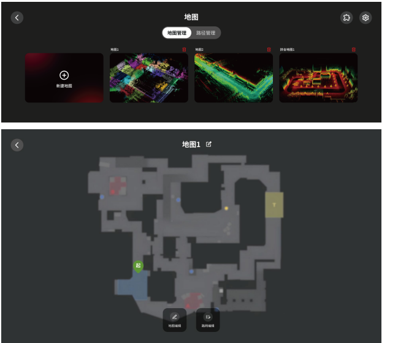

## 路网编辑

### 添加路网点

- 遥控添加：将机器人移动到真实位置后添加，位置更准确。
- 手动添加：直接在地图上添加，适合快速规划。

路网点不得放在障碍物或禁区内，应与墙体和障碍物保持安全距离。

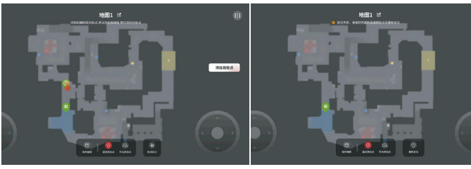

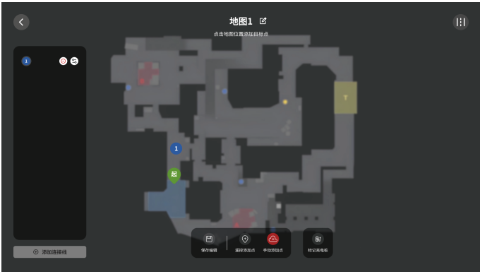

### 添加连接线

连接线表示机器人允许通行的路线。线段必须位于现场可通行区域，路网不能断联，应形成闭环或完整的端到端路径。保存路网后，在路径管理中重新检查已有任务路径。

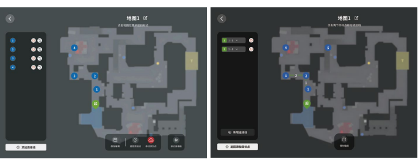

## 路径管理

1. 选择已完成路网编辑的地图。
2. 新建巡航任务路径，依次添加目标点。
3. 根据任务调整目标点顺序。
4. 将目标点设置为作业点或途径点。
5. 对临时障碍区域设置临时禁区。
6. 保存路径并检查每段连接线。

作业点用于到点执行拍照等任务，途径点只约束行驶路径。

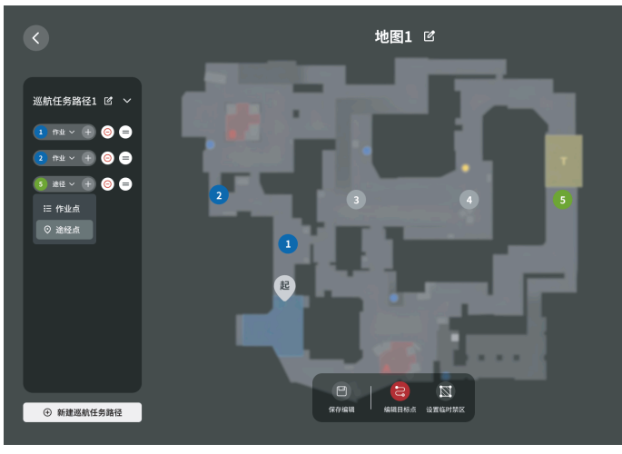

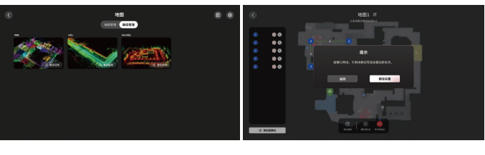

## 发起巡航

::: warning 巡航监控与急停
巡航期间持续观察位置、轨迹和目标点状态。可使用暂停、继续和结束巡航控制任务；遇到定位丢失、异常避障或人员进入路径时立即急停。
:::

1. 在路径管理中点击“发起任务”。
2. 填写任务名称并选择巡航路线。
3. 选择是否使用路网。
4. 设置低电量自动回充。
5. 设置任务结束动作为原地待命、返回起点或返回充电。
6. 确认配置后下发任务。

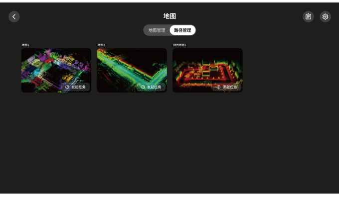

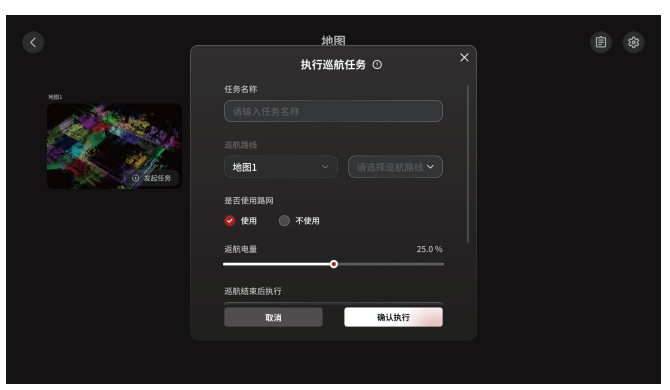

## 避障边界

| 项目 | 条件 |
| --- | --- |
| 静态障碍物 | 前向视野约 115°，高度和宽度均大于 30 cm，反射率不低于 10% |
| 动态障碍物 | 前向视野约 115° 内的行人，以及速度不超过 1.5 m/s 的车辆或两轮车 |
| 绕行空间 | 宽度大于机器人本体宽度加 60 cm |
| 前向盲区 | 激光雷达前方约 30 cm |

空间不足时机器人会刹停等待。快速车辆、低矮物体、透明物体、强反光物体和进入近距离盲区的障碍物需要人工重点监控。

## 自主回充与出桩

### 配置充电点

1. 在 App 中完成机器人与充电桩蓝牙配对。
2. 在路网编辑页面添加目标点。
3. 选中目标点并点击“标记充电桩”。
4. 调整充电点朝向，使其正对实体充电桩。
5. 保存地图和路网配置。

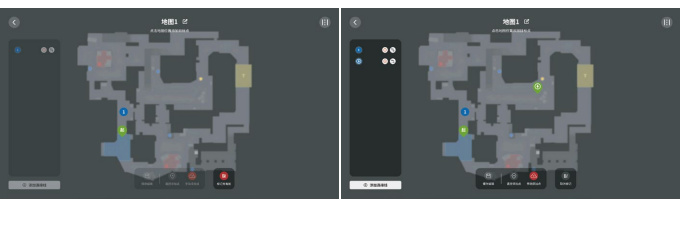

### 自动回充

任务配置中选择“返回充电桩”。巡航结束后，机器人返回充电点并执行对接。应同时检查任务状态和充电桩连接状态。

### 自动出桩

机器人在充电桩上时，下发新的巡航任务会先执行出桩，完成后开始巡航。

## 巡航记录

巡航记录按日期展示历史任务。详情页用于查看任务执行时间、路径、目标点结果和任务状态，可用于现场复盘和故障定位。

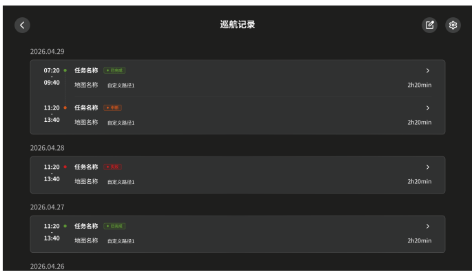

## 常见问题

### 初始定位失败

- 将机器人移回原建图轨迹附近。
- 保持机身朝向与建图初始方向一致，偏差控制在 ±15° 内。
- 让机器人位于原建图路径 2 m 范围内。
- 清洁雷达和相机，减少人员遮挡后重新定位。

### 巡航中定位丢失

- 检查前后雷达是否被上装、线缆或人员遮挡。
- 降低速度并回到环境特征丰富区域。
- 检查地图是否存在大面积噪点或现场结构变化。
- 无法恢复时结束任务，切换手动控制并移至安全位置。

### 无法绕障

- 检查可通行宽度是否满足机身宽度加 60 cm。
- 检查障碍物是否过低、透明、强反光或位于雷达近距离盲区。
- 设置临时禁区或重新规划路网。

### 回充失败

- 检查充电桩蓝牙连接和供电。
- 检查地图中的充电点位置与朝向。
- 清理充电桩前方路径和对接区域。
- 检查任务状态、错误码和充电桩连接状态。
