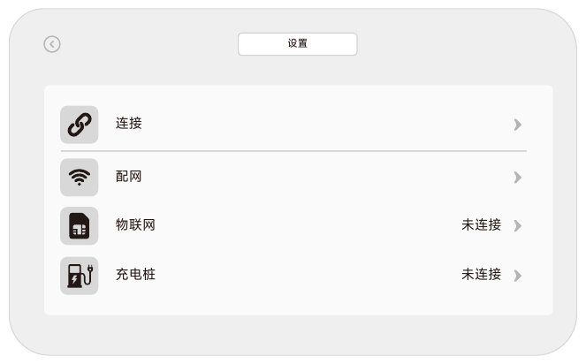

# L2 充电桩与任务

[SDK 接口参考](./07-sdk-api-reference.md) | [充电桩配对](#充电桩配对) | [回充与离桩任务](#回充与离桩任务)

## 充电桩配对

1. 安装选配充电桩。
2. 在 GenisDog 主页面点击设置图标，进入「充电桩」。
3. 按 App 提示完成机器人与充电桩的蓝牙配对。



L2-W Ultra 使用智航 Pro 自主回充时，配对后还需[配置地图充电点](./05-roamerx-pro-guide.md#配置充电点)。

## 任务与机器状态

```cpp
std::error_code StartRechargeTask(int timeout_ms = 0, WriteHandler handler = ...);
std::error_code StopRechargeTask(int timeout_ms = 0, WriteHandler handler = ...);
std::error_code StartUnDockTask(int timeout_ms = 0, WriteHandler handler = ...);
std::error_code StopUnDockTask(int timeout_ms = 0, WriteHandler handler = ...);
std::error_code SwitchRemoteState(int timeout_ms = 0, WriteHandler handler = ...);
std::error_code SwitchIdleState(int timeout_ms = 0, WriteHandler handler = ...);
```

任务接口需要可用充电桩、地图和机器人端配置。任务执行状态以 `OnTaskStateData()` 为主，`RobotState::machine_status` 为辅。状态切换见[远程与空闲状态](./09-control-ownership-tasks-and-peripherals.md#远程与空闲状态)。

## 回充与离桩任务

| 接口 | 功能 |
| --- | --- |
| `StartRechargeTask()` | 启动自主回充 |
| `StopRechargeTask()` | 停止回充任务 |
| `StartUnDockTask()` | 启动自主离桩 |
| `StopUnDockTask()` | 停止离桩任务 |

### 三层结果

| 层次 | 判断方式 | 含义 |
| --- | --- | --- |
| 发送层 | 返回值或 `WriteHandler` | 命令是否发出 |
| 应答层 | `OnStartRechargeTask()` 等 | 机器人是否确认收到命令 |
| 执行层 | `OnTaskStateData()` | 任务启动、运行、成功、失败或停止 |

```cpp
void OnTaskStateData(const TaskStateInfo& info) override {
    if (info.task_type == TaskType::RECHARGING) {
        if (info.task_status == TaskStatus::FAILURE) {
            // 记录 info.error_code，并转入安全处理
        }
    }
}
```

### 回充判断

启动回充后重点检查：

- `task_type == TaskType::RECHARGING`。
- `task_status` 是否进入 `STARTING` 或 `RUNNING`。
- `RobotState::machine_status == MachineStatus::RECHARGE`。
- `RobotState::charging_pile_connected` 是否在对接后变为 `true`。
- 电池状态是否进入 `PowerSupplyStatus::CHARGING`。

接口返回成功不能证明机器人已经到桩或开始充电。

### 离桩判断

启动离桩后检查：

- `task_type == TaskType::UNDOCK`。
- `task_status` 是否进入 `STARTING`、`RUNNING`，最终进入 `SUCCESS`。
- `RobotState::machine_status == MachineStatus::UNDOCK`。
- 离桩完成后充电桩连接状态是否解除。

### 任务运行要求

- 充电桩供电、蓝牙配对和地图充电点有效。
- 充电点朝向与实体充电桩一致。
- 相机和激光雷达无遮挡。
- 回充或离桩期间不发送 `Move()` 等普通运动命令。
- 任务失败后记录 `phase`、`error_code`、机器状态和电池状态。
