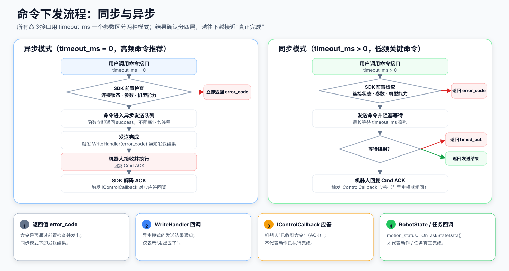

# L2 SDK 接口参考

[返回文档总览](../index.md) | [SDK 快速开始](./06-sdk-quickstart.md) | [回调、数据类型与状态](./08-callbacks-data-types-and-status-reference.md) | [L2 SDK 控制流程](./09-control-ownership-tasks-and-peripherals.md)

## 核心类

SDK 核心类为 `robot_sdk::SDKClient`，声明在 `include/robot_sdk/sdk_client.hpp`。公开接口统一使用 `std::error_code` 报告发送、超时、连接和能力检查结果。



## 接口分类

| 接口章节 | 主要内容 | 常用接口 |
| --- | --- | --- |
| [连接与设备信息](./07-01-connection-and-device-info.md) | 客户端构造、连接与断开、连接状态、版本和设备信息 | `SDKClient`、`Connect()`、`GetConnectionState()`、`GetDeviceInfo()` |
| [机器人控制](./07-02-robot-control.md) | 控制权、软件急停、姿态和运动命令 | `TakeControl()`、`SoftEmergencyStop()`、`StandUp()`、`Move()` |
| [数据上报](./07-03-data-reporting.md) | 回调注册、传感器与运动数据上报配置 | `SetDataCallback()`、`SetControlCallback()`、`SetImuConfig()` |
| [充电桩与任务](./07-04-dock-and-tasks.md) | App 蓝牙配对、回充与离桩任务、远程与空闲状态切换 | `StartRechargeTask()`、`StartUnDockTask()`、`SwitchIdleState()` |
| [外设与相机](./07-05-peripherals-and-camera.md) | 补光灯、相机码率、[相机节点与 Topic 配置](./camera-topic-configuration.md)、外设供电及 LED 控制 | `FrontLight()`、`UpdateCameraBitrate()`、`SetPeriphPower()`、`SetLedCommand()` |

## L2 系列设备类型

| 产品或设备形态 | `DeviceType` | 本文缩写 |
| --- | --- | --- |
| L2 点足版 | `L2F` | L2 |
| L2-W 轮足版 | `L2` | L2-W |
| L2-W Ultra | `L2_ULTRA` | L2-W Ultra |

## 接口能力表

`✓` 表示 SDK 不会因设备类型拒绝接口。`—` 表示 SDK 返回 `Errc::UnsupportedDeviceOperation`，并且不发送命令。

### 连接、信息与基础控制

| API | L2 | L2-W | L2-W Ultra |
| --- | :---: | :---: | :---: |
| `SDKClient()` / `~SDKClient()` | ✓ | ✓ | ✓ |
| `Connect()` / `Disconnect()` | ✓ | ✓ | ✓ |
| `IsConnected()` / `GetConnectionState()` | ✓ | ✓ | ✓ |
| `SetControlCallback()` / `SetDataCallback()` | ✓ | ✓ | ✓ |
| `Version()` / `ProtocolVersion()` / `SystemVersion()` | ✓ | ✓ | ✓ |
| `GetDeviceInfo()` | ✓ | ✓ | ✓ |
| `SoftEmergencyStop()` | ✓ | ✓ | ✓ |
| `ObstacleAvoidance()` (停障开关) | — | — | — |
| `StandUp()` / `BalanceStandUp()` / `LieDown()` | ✓ | ✓ | ✓ |
| `Stair()` / `Crawl()` / `CrawlWalk()` | ✓ | ✓ | ✓ |
| `Climb()` | — | — | — |
| `PosControl()` / `Locked()` / `SetSpeed()` | ✓ | ✓ | ✓ |
| `Gait()` | — | ✓ | ✓ |
| `Slim()` / `DSB()` / `SkWalk()` / `Sand()` | — | — | — |
| `ReverseHeadTail()` | — | — | — |

### 运动、灯光和数据

| API | L2 | L2-W | L2-W Ultra |
| --- | :---: | :---: | :---: |
| `Move()` / `PosMove()` | ✓ | ✓ | ✓ |
| `Turn()` / `ControlHead()` / `HighLowStance()` | ✓ | ✓ | ✓ |
| `FrontLight()` / `AutoModeLight()` | ✓ | ✓ | ✓ |
| `BackLight()` | — | — | — |
| `SetImuConfig()` / `SetLuxConfig()` | ✓ | ✓ | ✓ |
| `SetMcConfig()` / `SetSpeedReportConfig()` | ✓ | ✓ | ✓ |
| `SetJointStateConfig()` | ✓ | ✓ | ✓ |
| `UpdateCameraBitrate()` | ✓ | ✓ | ✓ |

### 控制权、任务和外设

| API | L2 | L2-W | L2-W Ultra |
| --- | :---: | :---: | :---: |
| `TakeControl()` / `ReleaseControl()` | ✓ | ✓ | ✓ |
| `StartRechargeTask()` / `StopRechargeTask()` | ✓ | ✓ | ✓ |
| `StartUnDockTask()` / `StopUnDockTask()` | ✓ | ✓ | ✓ |
| `SwitchRemoteState()` / `SwitchIdleState()` | ✓ | ✓ | ✓ |
| `SetPeriphPower()` / `GetPeriphPower()` | ✓ | ✓ | ✓ |
| `SetLedAutoMode()` / `GetLedAutoMode()` | ✓ | ✓ | ✓ |
| `SetLedCommand()` | ✓ | ✓ | ✓ |

能力允许不代表每次调用都会成功。连接、控制权、急停、机器人状态、参数范围和外设安装情况仍会影响执行结果。

## 通用参数和返回值

```cpp
using WriteHandler =
    std::function<void(const std::error_code&, std::size_t)>;
```

| 参数 | 说明 |
| --- | --- |
| `timeout_ms == 0` | 异步发送，结果由 `WriteHandler` 返回 |
| `timeout_ms > 0` | 同步等待，结果由函数返回值报告 |
| `handler` | 异步发送结果回调 |

常见错误：

| 错误 | 含义 |
| --- | --- |
| `std::errc::invalid_argument` | 参数超出范围或参数组合无效 |
| `std::errc::not_connected` | 连接未建立 |
| `std::errc::timed_out` | 同步等待超时 |
| `std::errc::operation_in_progress` | 相同操作正在执行 |
| `Errc::ShakeHandFailed` | 握手失败 |
| `Errc::ProtocolMismatch` | 通信协议版本不匹配 |
| `Errc::ControlledDenial` | 当前不能获得控制权 |
| `Errc::ConnectFailed` | 连接失败 |
| `Errc::UnsupportedDeviceOperation` | 当前设备类型不支持该接口 |
