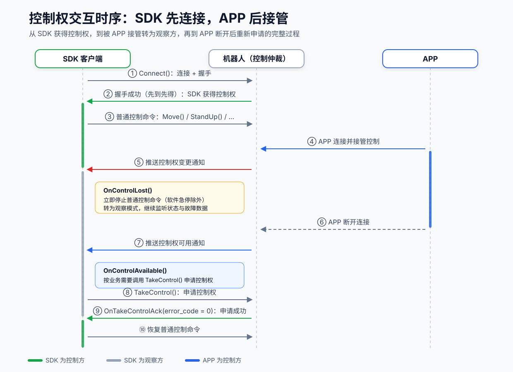

# L2 控制权、任务与外设控制

[返回文档总览](../index.md) | [SDK 接口参考](./07-sdk-api-reference.md) | [回调、数据类型与状态](./08-callbacks-data-types-and-status-reference.md) | [示例程序与故障排查](./10-examples-and-troubleshooting.md)

## 控制权模型

同一时间只有一个客户端拥有普通控制权。没有控制权的客户端仍可接收状态和故障信息，但不能执行普通姿态、运动、任务和设备控制命令。


### 控制权规则

| 规则 | 应用行为 |
| --- | --- |
| 首个控制端完成握手 | 可能直接成为控制方，仍应读取 `control_source` |
| App 接管 | SDK 收到 `OnControlLost()`，立即停止普通命令 |
| 控制权重新可用 | SDK 收到 `OnControlAvailable()`，由工作线程申请 |
| 申请成功 | `OnTakeControlAck()` 的 `error_code == 0` |
| 程序退出 | 先停止运动，再调用 `ReleaseControl()` |

### 控制权切换时序



### 控制权状态流转


### TakeControl

```cpp
std::error_code TakeControl(
    int timeout_ms = 0, WriteHandler handler = ...);
```

返回值表示命令是否发送或同步等待是否成功。业务结果由以下回调确认：

```cpp
void OnTakeControlAck(const TakeControlAck& ack) override {
    if (ack.error_code == 0) {
        // 已获得控制权
    } else {
        // ack.reason 包含失败原因
    }
}
```

### ReleaseControl

```cpp
std::error_code ReleaseControl(
    int timeout_ms = 0, WriteHandler handler = ...);
```

释放结果通过 `OnReleaseControlAck()` 返回。程序退出、切换到 App 或长时间不再发送控制命令时主动释放。

### 推荐控制流程

1. 注册数据回调和控制回调。
2. 连接机器人并确认状态为 `CONNECTED`。
3. 读取急停、故障和当前控制来源。
4. 等待 `OnControlAvailable()` 或直接尝试 `TakeControl()`。
5. 在 `OnTakeControlAck()` 中确认 `error_code == 0`。
6. 控制过程中监听 `OnControlLost()`。
7. 失去控制权后停止命令循环，并把目标速度清零。
8. 退出前释放控制权并断开连接。

## 回充与离桩任务

| 接口 | 功能 |
| --- | --- |
| `StartRechargeTask()` | 启动自主回充 |
| `StopRechargeTask()` | 停止回充任务 |
| `StartUnDockTask()` | 启动自主离桩 |
| `StopUnDockTask()` | 停止离桩任务 |

### 三层结果

| 层次 | 判断方式 | 含义 |
| --- | --- | --- |
| 发送层 | 返回值或 `WriteHandler` | 命令是否发出 |
| 应答层 | `OnStartRechargeTask()` 等 | 机器人是否确认收到命令 |
| 执行层 | `OnTaskStateData()` | 任务启动、运行、成功、失败或停止 |

```cpp
void OnTaskStateData(const TaskStateInfo& info) override {
    if (info.task_type == TaskType::RECHARGING) {
        if (info.task_status == TaskStatus::FAILURE) {
            // 记录 info.error_code，并转入安全处理
        }
    }
}
```

### 回充判断

启动回充后重点检查：

- `task_type == TaskType::RECHARGING`。
- `task_status` 是否进入 `STARTING` 或 `RUNNING`。
- `RobotState::machine_status == MachineStatus::RECHARGE`。
- `RobotState::charging_pile_connected` 是否在对接后变为 `true`。
- 电池状态是否进入 `PowerSupplyStatus::CHARGING`。

接口返回成功不能证明机器人已经到桩或开始充电。

### 离桩判断

启动离桩后检查：

- `task_type == TaskType::UNDOCK`。
- `task_status` 是否进入 `STARTING`、`RUNNING`，最终进入 `SUCCESS`。
- `RobotState::machine_status == MachineStatus::UNDOCK`。
- 离桩完成后充电桩连接状态是否解除。

### 任务运行要求

- 充电桩供电、蓝牙配对和地图充电点有效。
- 充电点朝向与实体充电桩一致。
- 相机和激光雷达无遮挡。
- 回充或离桩期间不发送 `Move()` 等普通运动命令。
- 任务失败后记录 `phase`、`error_code`、机器状态和电池状态。

## 远程与空闲状态

| 接口 | 目标状态 | 应答 |
| --- | --- | --- |
| `SwitchRemoteState()` | `MachineStatus::REMOTE` | `OnSwitchRemote()` |
| `SwitchIdleState()` | `MachineStatus::IDLE` | `OnSwitchIdle()` |

应答表示机器人收到切换命令，最终状态以 `RobotState::machine_status` 为准。

## 外设供电控制

```cpp
struct PowerCtrlCfg {
    PeripheralPower power;
    bool enable;
};

std::error_code SetPeriphPower(
    const PowerCtrlCfg& cfg, int timeout_ms = 0, WriteHandler handler = ...);

std::error_code GetPeriphPower(
    const PowerCtrlCfg& cfg, int timeout_ms = 0, WriteHandler handler = ...);
```

`SetPeriphPower()` 控制协议电源通道，`GetPeriphPower()` 查询通道状态。实际结果分别由 `OnSetPeriphPower()` 和 `OnGetPeriphPower()` 返回。

### 供电安全

- 先确认协议通道与 M12 的 24 V 输出、M14 的 VBAT 输出的对应关系。
- M12 的 24 V 输出与 M14 的 VBAT 输出各自的总功率均不超过 100 W。外设接入前确认 VBAT 的实际输出电压。
- 上电前检查外设额定电压、极性、启动电流和线束绝缘。
- 关闭通道前先让外设完成数据保存和正常停止。
- 应答成功后仍应通过外设状态或电压检测确认实际供电。
- 不得用软件开关代替保险、急停或硬件隔离。

## LED 控制

### 自动与手动模式

```cpp
std::error_code SetLedAutoMode(
    bool auto_mode, int timeout_ms = 0, WriteHandler handler = ...);
std::error_code GetLedAutoMode(
    int timeout_ms = 0, WriteHandler handler = ...);
```

自动模式由机器人根据运行、告警、低电和急停状态管理灯效。手动模式允许应用调用 `SetLedCommand()`。

### SetLedCommand

```cpp
struct LedColor {
    uint8_t r, g, b, a;
};

struct LedCommand {
    LedId id;
    LedEffect effect;
    LedColor color;
    uint32_t duration_ms;
};
```

| `LedId` | 含义 |
| --- | --- |
| `ALL` | 全部 LED |
| `FRONT` | 前部 LED |
| `BACK` | 后部 LED |

| `LedEffect` | 含义 |
| --- | --- |
| `OFF` | 关闭 |
| `ON` | 常亮 |
| `BREATH` | 呼吸 |
| `BLINK` | 闪烁 |
| `BLINK_TRANSIENT` | 瞬时闪烁 |

```cpp
LedCommand cmd{
    LedId::ALL,
    LedEffect::BLINK,
    {255, 128, 0, 255},
    300
};
client.SetLedCommand(cmd, 1000);
```

在手动灯效结束后恢复自动模式，避免覆盖急停、低电和故障指示。

## 退出和异常处理

发生以下事件时立即停止普通控制：

- `OnControlLost()`。
- 急停状态变为 `STOP`。
- 收到 `FatalError` 或 `Error` 级故障。
- 连接状态离开 `CONNECTED`。
- 任务状态进入 `FAILURE`。

正常退出顺序：发送零速度、停止运行任务、恢复 LED 自动模式、释放控制权、断开连接、等待工作线程退出。
