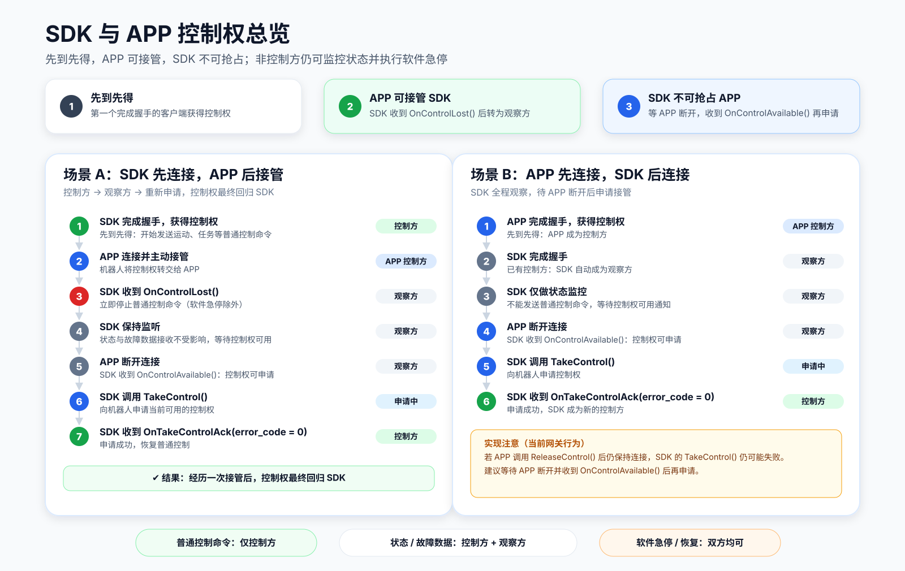
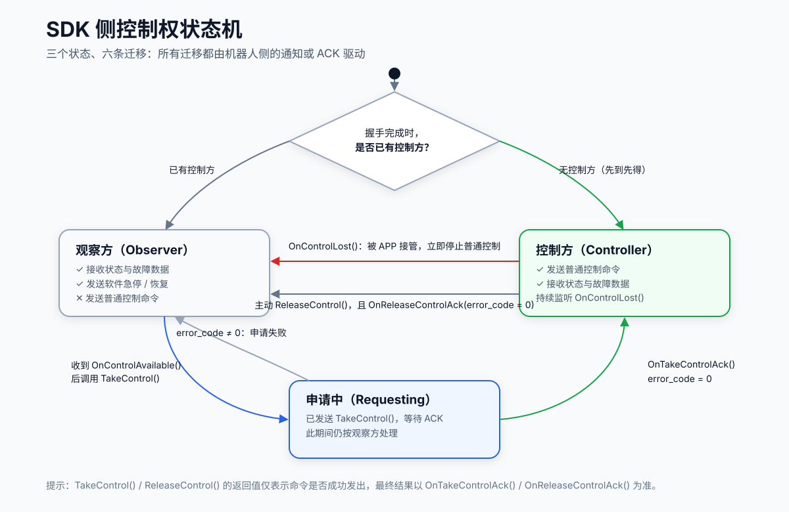

# L2 SDK 控制流程

[返回文档总览](../index.md) | [SDK 接口参考](./07-sdk-api-reference.md) | [回调、数据类型与状态](./08-callbacks-data-types-and-status-reference.md) | [示例程序与故障排查](./10-examples-and-troubleshooting.md)

## 控制权模型

同一时间只有一个客户端拥有普通控制权。没有控制权的客户端仍可接收状态和故障信息，但不能执行普通姿态、运动、任务和设备控制命令。



### 控制权规则

| 规则 | 应用行为 |
| --- | --- |
| 首个控制端完成握手 | 可能直接成为控制方，仍应读取 `control_source` |
| App 接管 | SDK 收到 `OnControlLost()`，立即停止普通命令 |
| 控制权重新可用 | SDK 收到 `OnControlAvailable()`，由工作线程申请 |
| 申请成功 | `OnTakeControlAck()` 的 `error_code == 0` |
| 程序退出 | 先停止运动，再调用 `ReleaseControl()` |

### 控制权切换时序


### 控制权状态流转



### TakeControl

```cpp
std::error_code TakeControl(
    int timeout_ms = 0, WriteHandler handler = ...);
```

返回值表示命令是否发送或同步等待是否成功。业务结果由以下回调确认：

```cpp
void OnTakeControlAck(const TakeControlAck& ack) override {
    if (ack.error_code == 0) {
        // 已获得控制权
    } else {
        // ack.reason 包含失败原因
    }
}
```

### ReleaseControl

```cpp
std::error_code ReleaseControl(
    int timeout_ms = 0, WriteHandler handler = ...);
```

释放结果通过 `OnReleaseControlAck()` 返回。程序退出、切换到 App 或长时间不再发送控制命令时主动释放。

### 推荐控制流程

1. 注册数据回调和控制回调。
2. 连接机器人并确认状态为 `CONNECTED`。
3. 读取急停、故障和当前控制来源。
4. 等待 `OnControlAvailable()` 或直接尝试 `TakeControl()`。
5. 在 `OnTakeControlAck()` 中确认 `error_code == 0`。
6. 控制过程中监听 `OnControlLost()`。
7. 失去控制权后停止命令循环，并把目标速度清零。
8. 退出前释放控制权并断开连接。

<a id="回充与离桩任务"></a>

通过 SDK 启动回充或离桩时，参阅[回充与离桩任务](./07-04-dock-and-tasks.md#回充与离桩任务)。

## 远程与空闲状态

| 接口 | 目标状态 | 应答 |
| --- | --- | --- |
| `SwitchRemoteState()` | `MachineStatus::REMOTE` | `OnSwitchRemote()` |
| `SwitchIdleState()` | `MachineStatus::IDLE` | `OnSwitchIdle()` |

应答表示机器人收到切换命令，最终状态以 `RobotState::machine_status` 为准。

<a id="外设供电控制"></a>
<a id="供电安全"></a>

外设供电接口与安全要求见[外设供电控制](./07-05-peripherals-and-camera.md#外设供电控制)。

<a id="led-控制"></a>
<a id="自动与手动模式"></a>
<a id="setledcommand"></a>

灯效模式与命令见 [LED 控制](./07-05-peripherals-and-camera.md#led-控制)。

## 退出和异常处理

发生以下事件时立即停止普通控制：

- `OnControlLost()`。
- 急停状态变为 `STOP`。
- 收到 `FatalError` 或 `Error` 级故障。
- 连接状态离开 `CONNECTED`。
- 任务状态进入 `FAILURE`。

正常退出顺序：发送零速度、停止运行任务、恢复 LED 自动模式、释放控制权、断开连接、等待工作线程退出。
