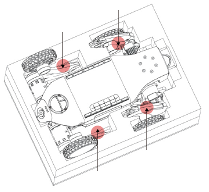
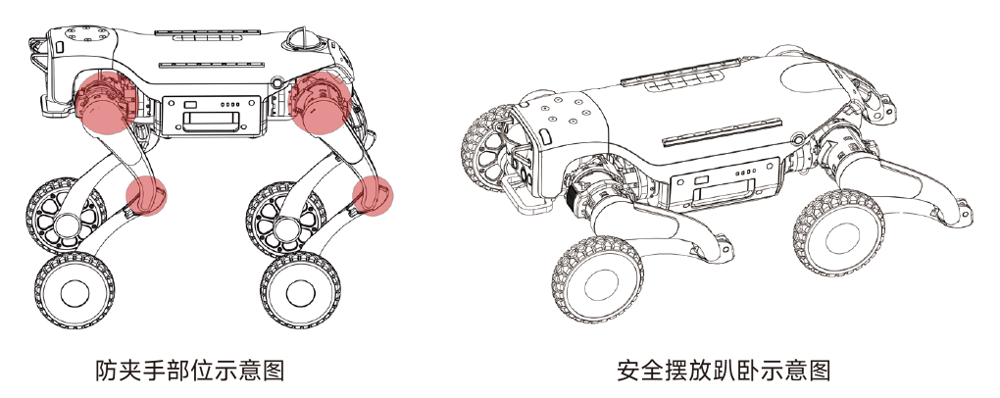
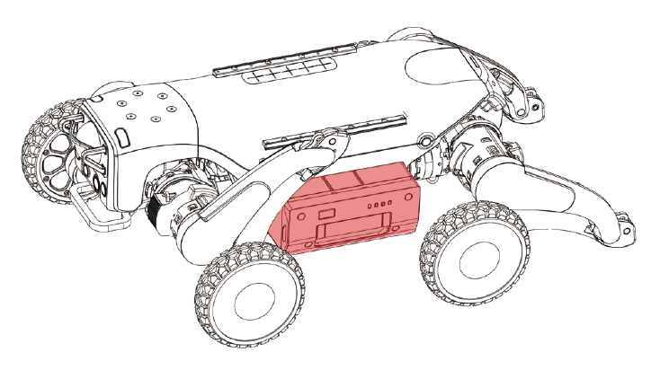
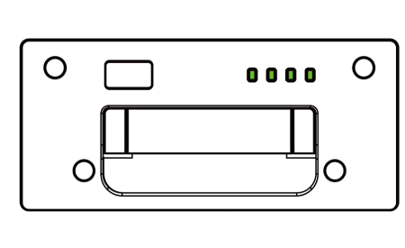
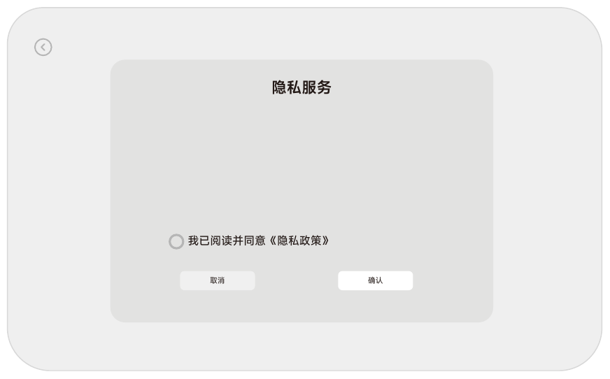
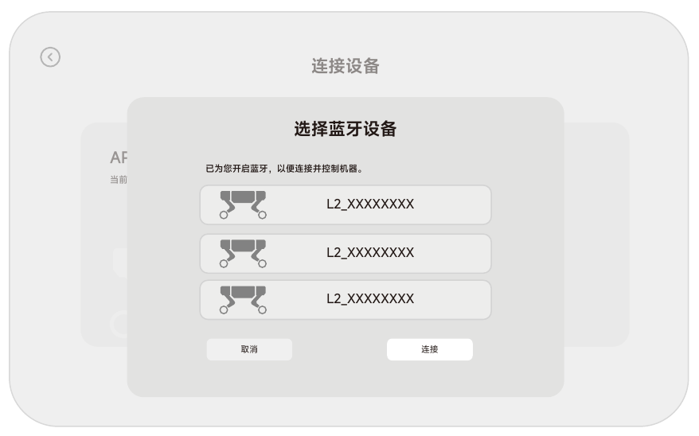
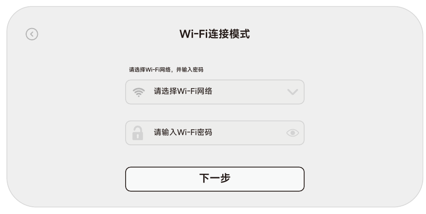
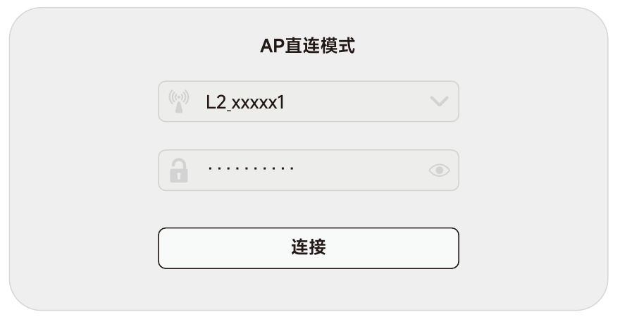
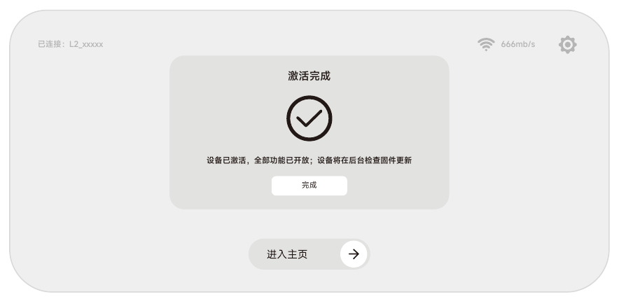

# L2 首次使用

[返回文档总览](../index.md) | [配件与设备组成](./02-accessories.md) | [设备操作、遥控器与 App](./04-device-controller-and-app-guide.md)

本页适用于 L2、L2-W 和 L2-W Ultra，涵盖开箱、安装电池、开机、联网和 GenisDog 首次激活。界面示意图来自产品使用说明书 V1.3，按钮名称以当前 App 界面为准。

## 开箱与摆放

1. 将包装箱平稳放在地面后打开。建议两人协作，确认机器人关机后用双手托住机身，缓慢平移取出。
2. 将机器人自然趴卧在平整、洁净、无尖锐凸起的地面上，四肢对称收拢。避免倒置、侧卧或让腿部承受非自然方向的重力。
3. 在机器人周围预留至少 1 m 的开机空间，使人员和物体远离运动路径。按[随箱组成和到货检查](./02-accessories.md#到货检查)核对配件和设备状况。

::: warning 搬运与防夹手
搬运时托住机身，禁止提拉腿部、轮足、相机、雷达或接口。手和衣物应避开髋关节与膝关节。需要调整腿部时，仅沿关节活动方向小角度调整，严禁逆限位用力掰动。
:::

## 安装电池

1. 确认机器人已关机并保持自然趴卧。
2. 握住电池拉带，按电池和电池仓上的方向标识插入电池。
3. 推至完全卡入并听到锁止声。确认电池与机身表面齐平，拉带无松动。

## 开机

1. 确认机器人自然趴卧、机身周围有至少 1 m 净空，人员和物体远离运动路径。首次运行前查看[使用前检查](./04-device-controller-and-app-guide.md#使用前检查)和[急停用法](./04-device-controller-and-app-guide.md#急停)。
2. 短按一次电池电源键，确认电量充足。首次使用建议机器人电量在 50% 以上。电量不足时先按[离机充电步骤](./04-device-controller-and-app-guide.md#电池离机充电)充电。
3. 再长按电池电源键 5 秒。松开后，电源指示灯亮起。
4. 等待机器人状态指示灯变为白色常亮，确认开机完成。

## 安装 GenisDog

- 使用安卓手机时，扫描下方二维码或[下载并安装 GenisDog App](https://p1iscu6mj28.feishu.cn/drive/folder/VlZffrW1il5Capdvy7yc4Sg7nqg?from=from_copylink)。
- L2-W Ultra 标配的 G12 带屏遥控器已内置 GenisDog App，可在遥控器上完成配网和激活。
- 首次激活前，准备可联网的 Wi-Fi 名称和密码，或可用的上网卡。

## 连接蓝牙

1. 确认机器人已开机，并打开手机或带屏遥控器的蓝牙。连接时靠近机器人。
2. 打开 GenisDog，阅读并同意隐私政策，点击「去连接」扫描附近设备。
3. 从列表中选中本机（如 `L2_123456`），点击「连接」。

## 选择连接方式

### Wi-Fi 配网

需要联网激活或升级时，选择「Wi-Fi 连接」。从列表中选择路由器的 Wi-Fi，输入密码并点击「下一步」，等待机器人联网成功。

### AP 直连

近距离操控可选择「AP 直连」。从列表中选择机器人的热点，输入对应密码，点击「连接」。使用 AP 直连时，如果机器人没有通过上网卡联网，首次激活前仍需按提示完成 Wi-Fi 配网。

## 首次激活

1. 连接后，App 自动检查激活状态。已激活的设备可直接进入主控页。
2. 首次激活时，确保机器人已通过 Wi-Fi 或上网卡联网。按 App 提示同步机器人和手机或带屏遥控器的时间。
3. 校时完成后机器人会自动重启。等待开机，再按 App 提示重新连接机器人。
4. 点击「确认激活」。看到「激活完成」后，进入主控页。

遇到蓝牙、Wi-Fi 或激活问题时，查看[设备故障排查](./04-device-controller-and-app-guide.md#设备故障排查)。日常使用时可在 App 中[切换连接方式](./04-device-controller-and-app-guide.md#切换连接方式)。
