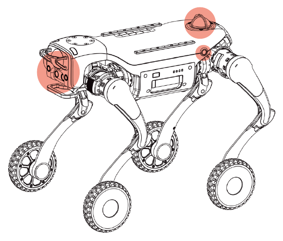

# L2 日常维护、存放与故障排查

[返回文档总览](../index.md) | [L2 设备操作与安全使用](./04-device-controller-and-app-guide.md)

## 日常维护

清洁或维护机器人前先关机，清洁充电座前拔下电源插头。请勿用水冲洗设备，或使用酒精、消毒液等腐蚀性溶剂清洁。

- 用干燥软布擦拭机身、补光灯和充电极片。
- 用专用镜头布或气吹清理双目、鱼眼相机镜头。用镜头布沿同一方向轻擦激光雷达，避免划伤光学窗口。
- 用软毛刷清理关节缝隙。禁止向关节喷洒液体或油品。关节出现异响时联系售后维护。

| 周期 | 检查与维护 |
| --- | --- |
| 每次使用前 | 检查机身与腿部连杆、关节、足垫或轮胎、紧固件、线束及接口盖。确认电池无鼓包或漏液，端子无异物，电池已完全卡入。检查图传，并在 10 m 内测试遥控信号是否稳定、操作是否及时响应。确认动作无卡顿、无异响。电量低于 20% 时应充电。 |
| 每周 | 清洁机身、传感器周围和关节缝隙，清理缠绕在轮胎上的杂物。检查关节活动、螺丝和线缆，确认无卡顿、异响、松动或磨损。 |
| 每月 | 清理内部缝隙的积尘，检查轮胎、腿部与机身连接处。检查电池外壳和底部端子。按说明书将电池放电至 30%，再充至 60%。 |

- L2 的足垫出现磨损、破损，或足部撞击地面的噪声明显增大时，应及时更换足垫。轮足机型的轮胎脱落、严重磨损或纹路磨平时，应及时更换轮胎。
- 涉水后先关机并擦干机身，可用吹风机低温档吹干轴承处。完成干燥检查后再继续操作。

## 存放

存放前清洁机器人、遥控器、电池和充电座的表面，防止液体进入接口或散热孔，并确认各部件外观无破损、功能正常。

计划停用超过 30 天时，将机器人关机并取出电池，以自然趴卧姿态放入专用包装箱。将电池电量充至 50%–60%，使电池端子与金属物品隔离。遥控器关机后放入保护套，充电器单独收纳。存放环境应干燥通风，温度为 -20 至 60 °C，远离强磁场和强振动源。包装箱上勿堆放重物。

- 存放 1 至 3 个月时，每月检查设备外观和电池电量。电池低于 40% 时补充至 50%–60%，存放期间至少每 3 个月充电一次。
- 存放超过 3 个月时，每月将电池放电至 30% 后充至 60%，每 2 个月让机器人通电运行 5 至 10 分钟，每 3 个月检查遥控器和充电器功能。
- 存放期间检查环境温度和湿度，及时更换失效的干燥剂。记录开始存放的日期、每次检查日期和维护情况。
- 从温差较大的存放环境取出设备后，等温度平衡再开机，避免结露。

## 设备故障排查

| 问题 | 检查与处理 |
| --- | --- |
| 无法开机或开机后立即关机 | 短按电池电源键检查电量。关机后重新安装电池，确认电池与机身表面齐平且拉带无松动。用干布擦净电池和机身金属触点。 |
| 遥控器无响应 | 确认机器人正常开机，检查急停状态。先排除导致急停的故障，再解除急停。急停已解除且仍无法操作时，重启机器人。 |
| App 搜不到机器人 | 确认机器人已开机，并已打开手机或带屏遥控器的蓝牙。靠近机器人后重新搜索，若仍搜不到，重启机器人后再试。 |
| 蓝牙连接失败 | 靠近机器人，确认在设备列表中选中名称以 `L2` 开头的本机。若仍无法连接，重启机器人后重试。 |
| Wi-Fi 密码错误或连接失败 | 重新输入正确密码。仍无法连接时，换用其他网络或稍后重试。 |
| 激活失败或超时 | 确认机器人已联网，重新配网后再次激活。 |
| L2-W Ultra 语音功能无法使用 | 在设置中打开语音功能开关。 |

问题仍未解决时，先保存相关数据并记录故障现象，再联系售后。SDK 联调问题见[示例程序与故障排查](./10-examples-and-troubleshooting.md)。
