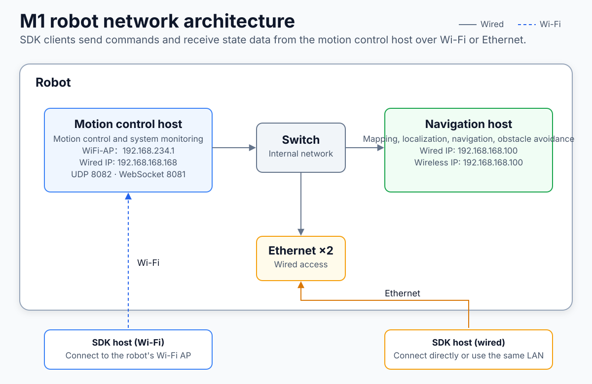

# Genisom M1 System Components, Hardware Interfaces, and Mechanical Design

[Documentation overview](../index.md) | [Operation and maintenance](./02-operation-and-maintenance.md) | [M1 SDK quickstart](./04-sdk-quickstart.md)

## System Components

The M1 includes a motion control host, navigation host, network switch, sensors, an expansion compartment, and external controllers.

### Hardware Architecture

The diagram shows how the main controller, compute board, sensors, power modules, and external interfaces connect.

### Network Architecture and Components

| Component | Responsibilities | Wired IP | Wireless IP |
| --- | --- | --- | --- |
| Motion control host | Motion control, system status, and SDK communication | `192.168.168.168` | `192.168.234.1` (Wi-Fi AP) |
| Navigation host | Mapping, localization, navigation, and obstacle avoidance | `192.168.168.100` | `192.168.168.100` |
| Network switch | Connects the motion control host, navigation host, and external Ethernet ports |  |  |
| External Ethernet port | Provides wired network access | Assigned by the LAN |  |
| SDK development computer | Runs your C++ program | Same network as the robot | Connects to the robot's Wi-Fi AP |

## Network and Communication Ports

The robot's Wi-Fi hotspot is named `M1-xxxxxxx`. The factory password is `12345678`.

Connect the development computer through the robot's Wi-Fi AP or external Ethernet port. The motion control host uses `192.168.234.1` over Wi-Fi and `192.168.168.168` over Ethernet. The navigation host uses `192.168.168.100` for both wired and wireless access. For connection and test steps, see the [M1 SDK quickstart](./04-sdk-quickstart.md#connect-to-the-robot).

| Device | Port | Protocol/ Use |
| --- | ---: | --- |
| Robot | 8081 | WebSocket for app control |
| Robot | 8082 | Default SDK UDP connection port |
| Robot | 8554 | RTSP video stream |

The SDK constructor defaults to `TransportProtocol::Udp`. For WebSocket, specify the protocol when constructing `SDKClient` and connect to port `8081`.

### SSH Access to the Compute Host

| Model | Compute board | Login IP | Username | Password |
| --- | --- | --- | --- | --- |
| Genisom M1 | NX/S100 | `192.168.168.100` | `robot` | `1` |

## Expansion Compartment

The expansion compartment on the robot's back provides mounting, power, and communication connections for payloads. Its power button independently controls the expansion interfaces.

| Number | Interface | Quantity or capacity |
| --- | --- | --- |
| ① | 48 V power | 10 A × 1 |
| ② | 24 V power | 20 A × 1 |
| ③ | 24 V + Ethernet | 24 V / 3 A + 1 Gigabit Ethernet port |
| ④ | 12 V + Ethernet | 12 V / 5 A + 1 Gigabit Ethernet port |
| ⑤ | Serial | RS232 × 1, RS485 × 1, SBUS × 2, PPS × 1 |
| ⑥, ⑦ | USB 3.0 | 5 V / 1 A, 2 ports |
| ⑧ | RTK antenna connector | 1 |
| ⑨ | Expansion compartment power button | Controls power to the expansion interfaces |

### Power and Protection

- The combined output of all expansion power connectors must stay at or below 480 W.
- Fit the protective caps to unused aviation connectors to maintain IP67 protection.
- When performing the platform-climbing stunt, remove all payloads and make sure the battery indicator shows at least two bars.

## Payload Design and Model Downloads {#payload-model-downloads}

Use the payload capacity reference and mounting space drawing when designing a payload. Check assembly clearance with the STP exterior model. Download the URDF model for simulation or kinematic modeling.

| Resource | Use | Download |
| --- | --- | --- |
| Genisom M1 payload capacity reference | Check payload design values | [Download PDF](../assets/downloads/m1-payload-design-reference.pdf) |
| Genisom M1 recommended mounting space | Check the recommended space for payload installation | [Download PDF](../assets/downloads/m1-mounting-space-reference.pdf) |
| Genisom M1 exterior model | Check external dimensions and assembly clearance | <a href="../assets/downloads/m1-exterior-model.zip" download>Download STP model (ZIP)</a> |
| Genisom M1 URDF model | Inspect links, joints, and geometry | <a href="../assets/downloads/m1-urdf.zip" download>Download URDF (ZIP)</a> |

## Video Streams

The M1 provides RTSP video streams on ports `8554` and `8555`. Check the device configuration for the stream URLs, front and rear camera assignments, and bitrates. Use `UpdateCameraBitrate()` to adjust the bitrate. See [camera bitrate](./06-05-peripherals-and-camera.md#camera-bitrate).
