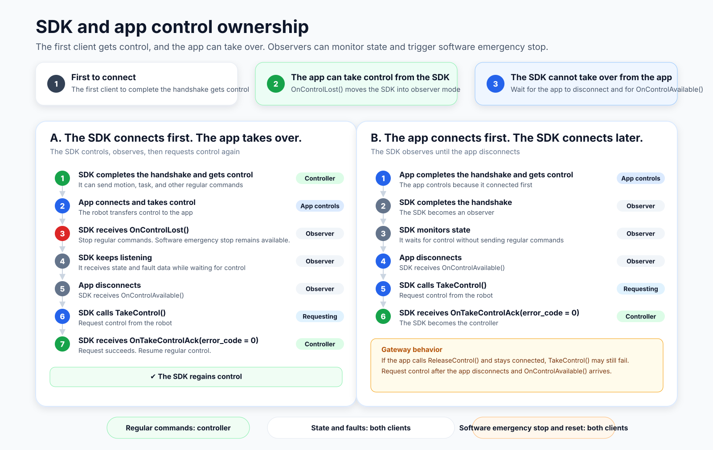
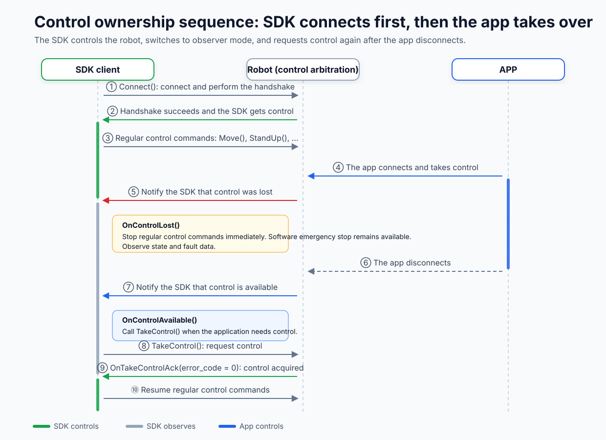

# Genisom M1 SDK Control Workflow

[Documentation overview](../index.md) | [M1 SDK quickstart](./04-sdk-quickstart.md) | [SDK API reference](./06-sdk-api-reference.md) | [Callbacks, data types, and status reference](./07-callbacks-data-types-and-status-reference.md)

## Application Workflow

A complete M1 SDK control program runs in the following order:

1. Create `SDKClient`.
2. Register `IDataCallback` and `IControlCallback`.
3. Call `Connect()` and wait for the handshake to succeed.
4. Call `GetDeviceInfo()` to verify the robot model.
5. Check control ownership and call `TakeControl()` if needed.
6. Send posture, motion, task, or peripheral commands.
7. Keep processing state data, faults, acknowledgments, and connection changes.
8. Stop motion, release control, and call `Disconnect(true)`.

## Three Levels of Call Results {#three-levels-of-call-results}

Check the send result, acknowledgment, and execution state separately.

| Level | Where to check | What it indicates |
| --- | --- | --- |
| API call | Return value or `WriteHandler` | Whether the API call returned an error |
| Acknowledgment | `IControlCallback` | Whether the robot received and processed the command |
| Execution | `RobotState` or `IDataCallback` | Whether the action or task is running, complete, or failed |

After a successful `StandUp()` call, check `RobotState::motion_status` to confirm the robot stood up. Use `OnTaskStateData()` to track task execution.

## Synchronous and Asynchronous Calls {#synchronous-and-asynchronous-calls}

Use `timeout_ms` and `WriteHandler` to choose how to call a command.

| Mode | Usage | How to get the result |
| --- | --- | --- |
| Asynchronous | `timeout_ms == 0` | The function returns immediately and `WriteHandler` reports the result later |
| Synchronous | `timeout_ms > 0` | The function waits for the result or timeout and returns a `std::error_code` |

Asynchronous example

```cpp
client.StandUp(0, [](const std::error_code& ec, std::size_t) {
    if (ec) {
        std::cerr << "call failed: " << ec.message() << std::endl;
    }
});
```

Synchronous example

```cpp
auto ec = client.StandUp(2000);
if (ec) {
    std::cerr << "call failed: " << ec.message() << std::endl;
}
```

Keep synchronous calls out of SDK callbacks. Callbacks run on the SDK I/O thread, so waiting synchronously can block subsequent acknowledgments and data processing.

## Control Ownership Mechanism {#control-ownership-mechanism}

Only one client at a time owns control and can send regular motion, posture, task, and device commands. Other connected clients can receive state and fault data.



### Control Ownership Rules

| Rule | Description |
| --- | --- |
| First to connect | The first client to complete the handshake obtains control automatically |
| Later connections | Later clients are observers. They receive state data but cannot send regular control commands |
| App takeover | The app can take control from the SDK. The SDK receives `OnControlLost()` |
| App has control | `TakeControl()` fails while the app stays connected and owns control |
| Controller disconnects | The SDK can request control after receiving `OnControlAvailable()` |
| Control lost | Immediately stop sending regular control commands and continuous motion commands |



### SDK Control States


| State | Meaning |
| --- | --- |
| `NO_CONTROL` | The SDK does not have control |
| `CONTROL_AVAILABLE` | The robot allows the SDK to request control |
| `HAS_CONTROL` | The SDK has control |

### Acquiring and Releasing Control

1. Register control ownership events and acknowledgment callbacks.
2. When the handshake completes, check whether the SDK has control.
3. If it does not, wait for `OnControlAvailable()`.
4. Call `TakeControl()` on the application's worker thread.
5. Check `error_code` in `OnTakeControlAck()`.
6. While controlling the robot, keep listening for `OnControlLost()`.
7. If control is lost, immediately stop sending regular control commands.
8. Before exiting, call `ReleaseControl()` and disconnect.

The prototype of the function is [M1 SDK Interface reference](./06-02-robot-control.md#control-ownership) and the event and response structure is [M1 callbacks, data types, and status reference](./07-callbacks-data-types-and-status-reference.md#control-ownership-events).

<a id="dock-pairing"></a>

See [Dock Pairing](./06-04-dock-and-tasks.md#dock-pairing) for pairing procedure and APIs.

<a id="docking-and-undocking-tasks"></a>
<a id="recharge-task-states"></a>
<a id="undocking-task-states"></a>

See [Docking and Undocking Tasks](./06-04-dock-and-tasks.md#docking-and-undocking-tasks) for task APIs and states.

## Switching Between Remote and Idle States

```cpp
std::error_code SwitchRemoteState(int timeout_ms = 0, WriteHandler handler = ...);
std::error_code SwitchIdleState(int timeout_ms = 0, WriteHandler handler = ...);
```

| Function | Purpose | Acknowledgment callback |
| --- | --- | --- |
| `SwitchRemoteState()` | Switch to remote control state | `OnSwitchRemote()` |
| `SwitchIdleState()` | Switch to idle state | `OnSwitchIdle()` |

The acknowledgment confirms that the robot processed the state change command. Check `RobotState::machine_status` to verify the actual state.
