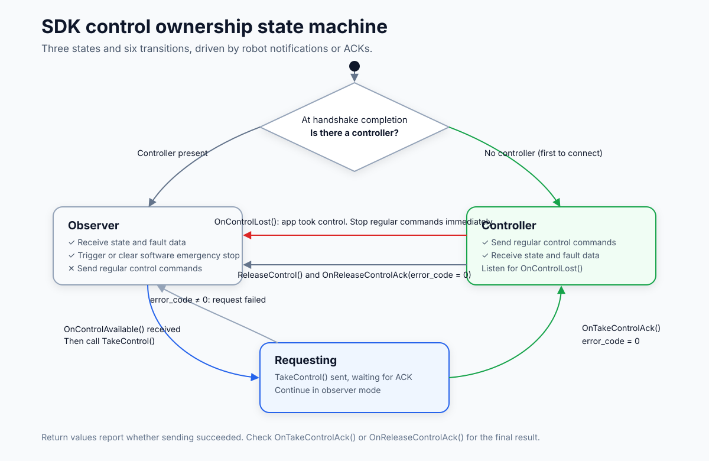

# M1 SDK control flow and task handling

[Documentation overview](../index.md) | [M1 SDK quickstart](./04-sdk-quickstart.md) | [SDK API reference](./06-sdk-api-reference.md) | [Callbacks, data types, and status reference](./07-callbacks-data-types-and-status-reference.md)

## Application workflow

A complete M1 SDK control program runs in the following order:

1. Create `SDKClient`.
2. Register `IDataCallback` and `IControlCallback`.
3. Call `Connect()` and wait for the handshake to succeed.
4. Call `GetDeviceInfo()` to verify the robot model.
5. Check control ownership and call `TakeControl()` if needed.
6. Send posture, motion, task, or peripheral commands.
7. Keep processing state data, faults, acknowledgments, and connection changes.
8. Stop motion, release control, and call `Disconnect(true)`.

## Three levels of call results {#three-levels-of-call-results}

Check the send result, acknowledgment, and execution state separately.

| Level | Where to check | What it indicates |
| --- | --- | --- |
| API call | Return value or `WriteHandler` | Whether the API call returned an error |
| Acknowledgment | `IControlCallback` | Whether the robot received and processed the command |
| Execution | `RobotState` or `IDataCallback` | Whether the action or task is running, complete, or failed |

After a successful `StandUp()` call, check `RobotState::motion_status` to confirm the robot stood up. After receiving the acknowledgment for a recharge request, track task execution through `OnTaskStateData()`.

## Synchronous and asynchronous calls {#synchronous-and-asynchronous-calls}

Use `timeout_ms` and `WriteHandler` to choose how to call a command.

| Mode | Usage | How to get the result |
| --- | --- | --- |
| Asynchronous | `timeout_ms == 0` | The function returns immediately and `WriteHandler` reports the result later |
| Synchronous | `timeout_ms > 0` | The function waits for the result or timeout and returns a `std::error_code` |

Asynchronous example

```cpp
client.StandUp(0, [](const std::error_code& ec, std::size_t) {
    if (ec) {
        std::cerr << "call failed: " << ec.message() << std::endl;
    }
});
```

Synchronous example

```cpp
auto ec = client.StandUp(2000);
if (ec) {
    std::cerr << "call failed: " << ec.message() << std::endl;
}
```

Keep synchronous calls out of SDK callbacks. Callbacks run on the SDK I/O thread, so waiting synchronously can block subsequent acknowledgments and data processing.

## Control ownership mechanism {#control-ownership-mechanism}

Only one client at a time owns control and can send regular motion, posture, task, and device commands. Other connected clients can receive state and fault data.


### Control ownership rules

| Rule | Description |
| --- | --- |
| First to connect | The first client to complete the handshake obtains control automatically |
| Later connections | Later clients are observers. They receive state data but cannot send regular control commands |
| App takeover | The app can take control from the SDK. The SDK receives `OnControlLost()` |
| App has control | `TakeControl()` fails while the app stays connected and owns control |
| Controller disconnects | The SDK can request control after receiving `OnControlAvailable()` |
| Control lost | Immediately stop sending regular control commands and continuous motion commands |


### SDK control states



| State | Meaning |
| --- | --- |
| `NO_CONTROL` | The SDK does not have control |
| `CONTROL_AVAILABLE` | The robot allows the SDK to request control |
| `HAS_CONTROL` | The SDK has control |

### Acquiring and releasing control

1. Register control ownership events and acknowledgment callbacks.
2. When the handshake completes, check whether the SDK has control.
3. If it does not, wait for `OnControlAvailable()`.
4. Call `TakeControl()` on the application's worker thread.
5. Check `error_code` in `OnTakeControlAck()`.
6. While controlling the robot, keep listening for `OnControlLost()`.
7. If control is lost, immediately stop sending regular control commands.
8. Before exiting, call `ReleaseControl()` and disconnect.

The prototype of the function is [M1 SDK Interface reference](./06-02-robot-control.md#control-ownership) and the event and response structure is [M1 callbacks, data types, and status reference](./07-callbacks-data-types-and-status-reference.md#control-ownership-events).

## Dock pairing {#dock-pairing}

SDK v0.2.3 supports scanning for, connecting to, querying, and disconnecting BLE charging docks. Verify that the robot system supports pairing, then register the data and control callbacks and run the following from the application thread.

1. Call `SetDockScanConfig(true)`. Wait for `OnDockScanConfig(true)` to confirm scanning has started.
2. Use `OnDockScanResult()` to receive scan reports and update the device list by address. Select a dock whose `connectable` is `true` and save its address.
3. Call `SetDockScanConfig(false)`. When scanning has stopped, set `DockConnectConfig::address` to the selected address and call `ConnectDock()`.
4. Check `accepted` in `OnDockConnectionAck()`. If the request was accepted, wait for `OnDockConnectionResult()` and check `success` and `error_code`.
5. After pairing, call `GetDockInfo()` and check `dock_connected`, `has_contact`, and `charging_active` in `OnDockInfo()`.
6. To disconnect, call `DisconnectDock()` and wait for both the acknowledgment and the final result.

Run one connection or disconnection operation at a time. Check the API return value and `WriteHandler` for the call and send results, then use `OnDockConnectionResult()` for the final pairing result. During autonomous docking or undocking, `OnTaskStateData()` reports progress and the final result.

See the [API signatures](./06-04-dock-and-tasks.md#dock-pairing), [callbacks and data structures](./07-callbacks-data-types-and-status-reference.md#dock-data), and [pairing example](./08-examples-and-troubleshooting.md#dock-pairing-example).

## Docking and undocking tasks {#docking-and-undocking-tasks}

| Function | Purpose |
| --- | --- |
| `StartRechargeTask()` | Start autonomous docking for charging |
| `StopRechargeTask()` | Stop the autonomous docking task |
| `StartUnDockTask()` | Start autonomous undocking |
| `StopUnDockTask()` | Stop autonomous undocking |

Check the API call, acknowledgment, and execution result for task commands. Acknowledgments such as `OnStartRechargeTask()` indicate that the robot processed the start or stop request. Use `OnTaskStateData()` to track execution and the final result.

```cpp
void OnTaskStateData(const TaskStateInfo& info) override {
    if (info.task_type == TaskType::RECHARGING) {
        // Processing task status according to info.task_status and info.error_code
    }
}
```

### Recharge task states

After calling `StartRechargeTask()`, the recharge task may report the following states.

- `STARTING`: Task is starting.
- `RUNNING`: Task is running.
- `FAILURE`: Task failed to start or complete. Check `TaskStateInfo::error_code`.

The recharge task does not transition to `SUCCESS` on its own. To end it, call `StopRechargeTask()` and wait for `TaskType::RECHARGING` to reach `STOPPED`. Use `OnStartRechargeTask()`, `TaskStateInfo`, and `MachineStatus::RECHARGE` together to determine whether the task is running.

### Undocking task states

After `StartUnDockTask()`, the task may progress through `STARTING -> RUNNING -> SUCCESS`. If it fails, it transitions to `FAILURE`. `TaskType::UNDOCK` with `TaskStatus::SUCCESS` confirms that undocking completed.

To stop undocking in progress, call `StopUnDockTask()` and wait for `TaskType::UNDOCK` to reach `STOPPED`.

See [task and robot state APIs](./06-04-dock-and-tasks.md#task-and-robot-states) and the [task state structure](./07-callbacks-data-types-and-status-reference.md#task-state).

See the SDK guide for [recharge, undocking, and dock calibration requirements and troubleshooting](https://github.com/zsibot/genisom_robot_sdk/blob/main/docs/zh/sdk_recharge_undock_calibration_conditions_zh.md).

## Switching between remote and idle states

| Function | Purpose | Acknowledgment callback |
| --- | --- | --- |
| `SwitchRemoteState()` | Switch to remote control state | `OnSwitchRemote()` |
| `SwitchIdleState()` | Switch to idle state | `OnSwitchIdle()` |

The acknowledgment confirms that the robot processed the state change command. Check `RobotState::machine_status` to verify the actual state.
