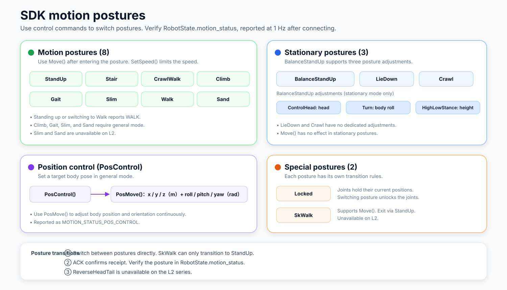

# Robot Control

[Overview of interfaces](./06-sdk-api-reference.md) | [Common parameters and return values](./06-sdk-api-reference.md#common-parameters-and-return-values)

## Control Ownership {#control-ownership}

### TakeControl

```cpp
std::error_code TakeControl(
    int timeout_ms = 0,
    WriteHandler handler = [](const std::error_code&, std::size_t) {});
```

Request normal control of the robot. The return value indicates whether the request was sent. Check the `error_code` in `OnTakeControlAck()` to determine whether the robot granted control.

### ReleaseControl

```cpp
std::error_code ReleaseControl(
    int timeout_ms = 0,
    WriteHandler handler = [](const std::error_code&, std::size_t) {});
```

Release control when the application exits or finishes controlling the robot.

For the process of application, taking over and restoration of control, see [Genisom M1 SDK Control Workflow](./05-sdk-control-flow-and-task-handling.md#control-ownership-mechanism).

## Safety Controls {#security-control}

### SoftEmergencyStop

```cpp
std::error_code SoftEmergencyStop(
    bool on, int timeout_ms = 0,
    WriteHandler handler = [](const std::error_code&, std::size_t) {});
```

Set `on == true` to trigger the software emergency stop or `on == false` to clear it. The software emergency stop is available regardless of control ownership. The software emergency stop cannot replace the robot’s physical emergency stop.

`IControlCallback::OnSoftEmergencyStop(bool on)` reports the acknowledgment. Read `RobotState::software_emergency_status` to check the current state.

## Posture Control

These methods take only the common parameters `timeout_ms` and `handler`.

| Function | Prototype | Behavior |
| --- | --- | --- |
| `StandUp` | `std::error_code StandUp(int timeout_ms = 0, WriteHandler handler = ...)` | Stand |
| `Walk` | `std::error_code Walk(int timeout_ms = 0, WriteHandler handler = ...)` | Switch to a posture that allows walking |
| `BalanceStandUp` | `std::error_code BalanceStandUp(int timeout_ms = 0, WriteHandler handler = ...)` | Stand in a balanced posture |
| `LieDown` | `std::error_code LieDown(int timeout_ms = 0, WriteHandler handler = ...)` | Lie down |
| `Stair` | `std::error_code Stair(int timeout_ms = 0, WriteHandler handler = ...)` | Switch to stair-climbing posture |
| `Crawl` | `std::error_code Crawl(int timeout_ms = 0, WriteHandler handler = ...)` | Switch to a crawling posture |
| `CrawlWalk` | `std::error_code CrawlWalk(int timeout_ms = 0, WriteHandler handler = ...)` | Move while crawling |
| `Climb` | `std::error_code Climb(int timeout_ms = 0, WriteHandler handler = ...)` | Climb onto a raised platform |
| `Gait` | `std::error_code Gait(int timeout_ms = 0, WriteHandler handler = ...)` | Switch to a precision gait |
| `Slim` | `std::error_code Slim(int timeout_ms = 0, WriteHandler handler = ...)` | Narrow the stance to pass through a tight space |
| `PosControl` | `std::error_code PosControl(int timeout_ms = 0, WriteHandler handler = ...)` | Switch to position-control posture |
| `SkWalk` | `std::error_code SkWalk(int timeout_ms = 0, WriteHandler handler = ...)` | Walk with matching knee posture |
| `Sand` | `std::error_code Sand(int timeout_ms = 0, WriteHandler handler = ...)` | Switch to a posture for sandy terrain |
| `ReverseHeadTail` | `std::error_code ReverseHeadTail(int timeout_ms = 0, WriteHandler handler = ...)` | Reverse the robot’s front and rear directions |
| `Locked` | `std::error_code Locked(int timeout_ms = 0, WriteHandler handler = ...)` | Lock joint position |



After standing, `RobotState::motion_status` usually becomes `MOTION_STATUS_WALK`, which means that the robot is standing and moving. `Locked()` will maintain the current joint position, and other posturing orders will be unlocked.

`Walk()` provided from v0.2.3. Upon receipt `IControlCallback::OnWalk()`, confirm by `RobotState::motion_status` whether the posture has been switched to `MOTION_STATUS_WALK`.

## Movement Control

### Move

```cpp
std::error_code Move(
    float left_right, float forward_back, float yaw,
    int timeout_ms = 0,
    WriteHandler handler = [](const std::error_code&, std::size_t) {});
```

Sends the ratio of smoothing and rotation speeds in a general motion state.

| Parameter | Scope | Description |
| --- | --- | --- |
| `left_right` | `[-1.0, 1.0]` | Lateral movement ratio. Positive values move left and negative values move right. |
| `forward_back` | `[-1.0, 1.0]` | Longitudinal movement ratio. Positive values move forward and negative values move backward. |
| `yaw` | `[-1.0, 1.0]` | Rotation ratio. Positive values turn left and negative values turn right. |

The actual speed depends on the setting selected with `SetSpeed()`. The robot normally applies the latest `Move()` command for about 1 s. For continuous motion, send commands at 10–20 Hz.

### MoveVelocity

```cpp
std::error_code MoveVelocity(
    float x, float y, float yaw, int timeout_ms = 0,
    WriteHandler handler = [](const std::error_code&, std::size_t) {});
```

Send velocities in physical units in the robot’s body frame. `x` is forward velocity and `y` is lateral velocity. Positive `x` points forward and positive `y` points left, both in m/s. `yaw` is angular velocity around the vertical axis in rad/s, with positive rotation defined by the right-hand rule.

The current `SetSpeed()` setting limits velocity. For continuous motion, send commands at 10–20 Hz. NaN or infinite inputs return `std::errc::invalid_argument`. Check the send result through `WriteHandler`. This method has no dedicated control acknowledgment.

### PosMove

```cpp
std::error_code PosMove(
    PosControlCmd cmd, int timeout_ms = 0,
    WriteHandler handler = [](const std::error_code&, std::size_t) {});
```

Send a target pose in position-control mode. Call `PosControl()` first.

```cpp
struct PosControlCmd {
    float x;
    float y;
    float z;
    float roll;
    float pitch;
    float yaw;
};
```

`x/y/z` in m, `roll/pitch/yaw` in rad.

### Turn

```cpp
std::error_code Turn(
    int direction, int timeout_ms = 0,
    WriteHandler handler = [](const std::error_code&, std::size_t) {});
```

Turn the robot in place. Use `0` to return to the neutral position, `1` to turn left, or `2` to turn right. Other values return `std::errc::invalid_argument`.

### ControlHead

```cpp
std::error_code ControlHead(
    float left_right, float up_down, int timeout_ms = 0,
    WriteHandler handler = [](const std::error_code&, std::size_t) {});
```

Look left or right and tilt up or down in stationary mode. Both parameters range from `-1.0` to `1.0`. Positive values mean left and up, respectively. Negative values mean right and down.

### HighLowStance

```cpp
std::error_code HighLowStance(
    int stance, int timeout_ms = 0,
    WriteHandler handler = [](const std::error_code&, std::size_t) {});
```

Adjust standing height. Use `0` for the default stance, `1` for a high stance, or `2` for a low stance.

### SetSpeed

```cpp
std::error_code SetSpeed(
    int speed_level, int timeout_ms = 0,
    WriteHandler handler = [](const std::error_code&, std::size_t) {});
```

Set the speed level for `Move()`. Use `1` for low, `2` for medium, or `3` for high. Other values return an invalid-parameter error. Higher speed levels allow a smaller range of combined lateral movement and rotation.
